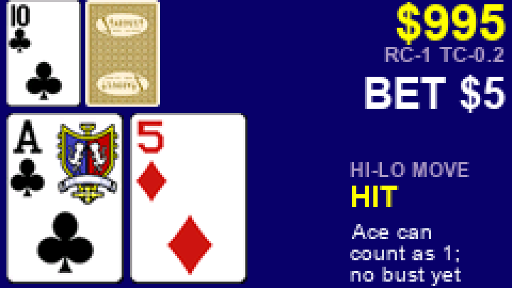

# Blackjack Trainer

Stardust Blackjack is a compact table simulator and trainer for the **M5Stack StickS3**, with a browser version using the same game and 240×135 interface. It is designed for players who already know blackjack: play an ordinary table, practice a count, or review decisions against basic strategy or the supported Hi-Lo index policy.

**Current version: 0.11.2.** New-install defaults: **Hi-Lo · Fast · 20% volume**. An ordinary boot starts with **$1,000**, the table minimum, and training **Off**. Saved preferences take precedence.

[Quickstart](docs/PLAY.md) · [Every feature](docs/FEATURE_GUIDE.md) · [Screen walkthrough](docs/SCREEN_GUIDE.md) · [Install / browser](docs/INSTALL.md)

## The table

The normal view keeps the cards, bankroll, bet and necessary turn/result information prominent. Counts, advice, EV and reports appear only when requested or enabled by a training mode.

*Screenshots use reproducible demonstration sessions rather than a player's saved game. The screen guide identifies each view and its controls.*

## Start a hand

Press **Blue twice** to accept the randomized player cut, skip the burn notice and deal. During your turn, **Grey hits** and **Blue stands**. Hold **Grey** for the menu; legal Double, Split and Surrender choices appear first. Hold **Blue** to cycle training modes.

| Situation | Grey | Blue |
|---|---|---|
| Playing turn | Hit | Stand |
| Between hands | Choose wager | Deal |
| Menu | Next row | Select |
| Hold | Unified menu / return | Off → Test → Coach → Guide |
| Count-answer quiz | Decrease | Increase; both buttons submit |

The browser maps **Left Arrow to Grey** and **Right Arrow to Blue**, including holds. Volume and brightness editors use Grey− / Blue+; hold Grey returns. In Volume, hold Blue auditions a sound.

## Four modes

| Mode | What changes |
|---|---|
| **Off** | Ordinary play without automatic strategy coaching or live card-decision grading. |
| **Test** | Record first choices, then open a review after the round. |
| **Coach** | Pause before a mistaken choice is executed; inspect the explanation and choose how to continue. |
| **Guide** | Display the recommended move and reason during play. RC+TC appear by default in this mode. |

**Mode, strategy and count display are independent.** Hi-Lo applies the supported published count-index deviations; Basic uses the selected rules without count deviations. Merely showing a count does not change the policy. First answers remain recorded, and assistance has separate scores. [Mode and scoring details](docs/FEATURE_GUIDE.md#choose-teaching-policy-and-aids-separately).

## Practice and review

| Feature | What you can inspect or practice |
|---|---|
| **Count practice** | Running count, decks remaining and true-count conversion, with separate question history and scores. |
| **Wager practice** | A frozen predeal count, an explicit example ramp and legal table/bankroll caps. Your submitted wager can be played. |
| **Deviation drills** | 31 focused situations, threshold explanations, missed-question replay and immutable first-attempt results. |
| **Action EV** | Expected net under the stated infinite-replacement model, including bounded funded split estimates and partial/unavailable labels. |
| **Decision review** | Original choice, selected policy, count context and assistance retained with the attempt. |
| **Session analysis** | Settled money/history, outcomes, dispersion/drawdown, accuracy, weak areas and scoped model comparisons. |
| **Table setup** | Six supported generic profiles, limits, player cut, dealer marker and up to six other seats. |
| **Settings** | Percentage sound/brightness, three sound categories, auditions, screen flip and Normal/Fast pacing. |
| **Optional resume** | Explicit restoration of a matching private checkpoint, including the live shoe and pending exercise. Off by default. |

The [complete feature guide](docs/FEATURE_GUIDE.md) covers every menu and workflow. The [illustrated screen guide](docs/SCREEN_GUIDE.md) follows the game from cut and deal through training, reports, settings and recovery.

## Rules and model scope

The default is six decks, H17, DAS, late surrender, 3:2 and $5–$500 limits, with a 75% dealer marker. All presets and restrictions are explicit in [Table rules](docs/TABLE_RULES.md); they are generic profiles rather than claims about a named casino's current offering.

Cards come from a finite shoe. Advice follows Basic or the named BJA2018 Hi-Lo policy using exposed information. EV is a separate **infinite-replacement** model; it does not inspect the hidden shoe or turn a count into exact composition-dependent EV. The example wager ramp is not a universal optimal betting system. [Count policy](docs/count-reference.md) · [EV and analysis](docs/SESSION_ANALYSIS.md).

## Run or install

- **Browser:** serve the included browser folder locally and use the same two controls. [Browser instructions](docs/INSTALL.md#browser).
- **StickS3:** use the matching firmware and preserve your device backup. [Installation and update guide](docs/INSTALL.md#sticks3).
- **Source:** the shared game, renderer and hardware application are Rust. [Build and validation](docs/BUILD.md) · [Firmware details](firmware/README.md).

Preferences and lifetime scores are separate from optional full-session checkpoints. Ordinary boot starts fresh; only an explicit resume restores the live session. [Saving and recovery](docs/RESUME.md).

## Releases and verification

The roadmap through 0.10 is implemented; later releases refine controls and defaults. [Release history](docs/ROADMAP.md) · [Current release](docs/RELEASE-0.11.2.md).

Automated native, mathematical, browser and firmware checks are recorded separately from actual-device checks. The current update passed targeted strategy/controller/persistence tests, 7,200 browser rounds, 60 deep tablemate rounds and resume/fault checks. Actual Stick checks verified Hi-Lo after restart and preserved saved progress. Earlier sound validation included user-confirmed audible deal and win cues. [Scoped validation record](validation/release-0.11.2.json).

## Project and publication notes

This is an independent virtual-chip simulator, not an official casino or VideoPoker.com product. The current interface reuses source-derived materials with separate rights notices. Code metadata, inherited assets and their notices must not be treated as a single blanket license. [Attribution and asset provenance](docs/asset-provenance.md) · [Publication review](docs/PUBLISHING.md).

Private device dumps, player saves, local build caches and personal validation sessions are excluded. Third-party assets retain their owners' rights; publication does not turn those assets into MIT-licensed material. See the retained provenance and rights notices.
