# Blackjack Trainer

**[Open the flasher](https://xn--sg8hhb.ws/flasher/) · [Install on StickS3](docs/INSTALL.md#sticks3) · [Install on Waveshare 1.75C](docs/WAVESHARE.md#install-or-update) · [Play in your browser](https://xberenguer.github.io/blackjack-trainer/)**

Stardust Blackjack is a two-button blackjack simulator and trainer for the **M5Stack StickS3** and **Waveshare 1.75C round display**, with a browser version using the same Rust game and the Stick’s 240×135 interface. This illustrated guide assumes you already know regular blackjack and explains every app feature. Both hardware targets share this repository and release version. Choose your device in the flasher to download the matching firmware.

**Current version: 0.12.2.** New-install preferences: **Hi-Lo · Fast · 20% volume**. Saved preferences take precedence; ordinary boot starts at **$1,000**, the table minimum and training **Off**.

| M5Stack StickS3 | Waveshare AMOLED 1.75C |
| :---: | :---: |
| [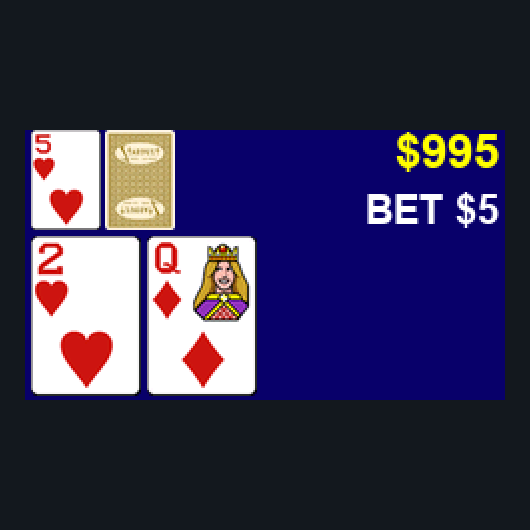](docs/media/compare/stick-table.png) | [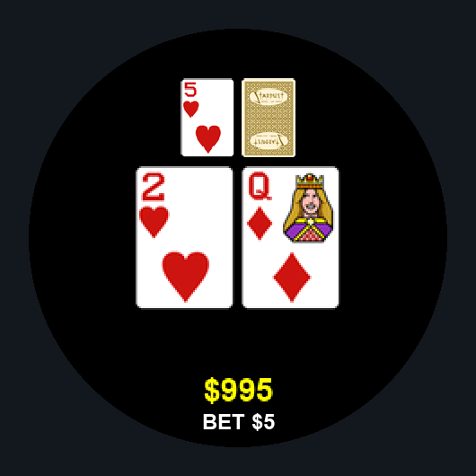](docs/media/compare/waveshare-table.png) |
| **240×135** · Grey and Blue controls | **466×466** · Right and Left controls |
| [StickS3 installation](docs/INSTALL.md#sticks3) · [StickS3 screen gallery](docs/SCREEN_GUIDE.md) | [Waveshare installation](docs/WAVESHARE.md#install-or-update) · [Waveshare screen gallery](docs/WAVESHARE.md#a-layout-for-the-circle) |

The previews show the same synthetic hand on both displays. Click to enlarge. The [menu gallery](docs/MENUS.md) compares both models throughout Settings and Training.

## Find a topic

- [Waveshare round guide](docs/WAVESHARE.md), [current menu gallery](docs/MENUS.md) and [Stick screen gallery](docs/SCREEN_GUIDE.md)
- [Controls and the menu](#two-buttons-different-contexts)
- [Modes, strategy, count display and scoring](#choose-teaching-policy-and-aids-separately)
- [Count practice](#count-practice-three-separate-skills), [wager practice](#wager-practice-example-ramp-arithmetic) and [deviation drills](#deviation-drills-focused-synthetic-decisions)
- [Action EV](#action-ev-and-ev-review)
- [Table, shoe, seating and manual wagers](#table-setup-shoe-and-manual-money-controls)
- [Session reports](#session-totals-and-analysis)
- [Settings](#settings-sound-display-speed-and-count-aids)
- [Save/resume and storage recovery](#save-and-resume)
- [Training paths](#three-suggested-training-paths) and [trainer glossary](#trainer-glossary)

## First installation and returning players

A normal boot starts a new game with **$1,000**, the table minimum selected, training **Off**, and a randomized player-cut position. Press **Blue twice** on StickS3 or the **large Left button twice** on Waveshare to accept the cut and deal through the burn notice. If the notice clears by itself, press the same button at the ready table to deal.

New-install preferences are Hi-Lo strategy, Fast speed, sound on at 20%, all three sound categories enabled, full brightness, no screen flip, no tablemates, no automatic wager-practice prompts and resume off. The default table is six decks, H17, DAS, late surrender, 3:2 blackjack, $5–$500 limits and a 75% dealer marker. Normal count display is off; Guide has its own RC+TC display default.

Existing saved choices are respected: selecting Basic is not overwritten by the new-install Hi-Lo default. Older V1–V4 saves retain Basic. Normal preference loading always starts training Off; **explicitly resuming a saved session** can restore another live mode.

| 1. Accept or move the player cut | 2. Skip the ready notice with Blue |
|---|---|
| [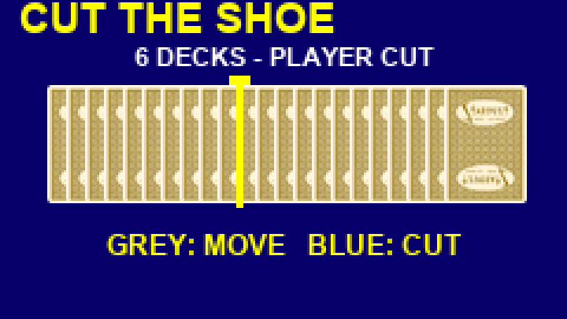](docs/media/screens/cut.png) | [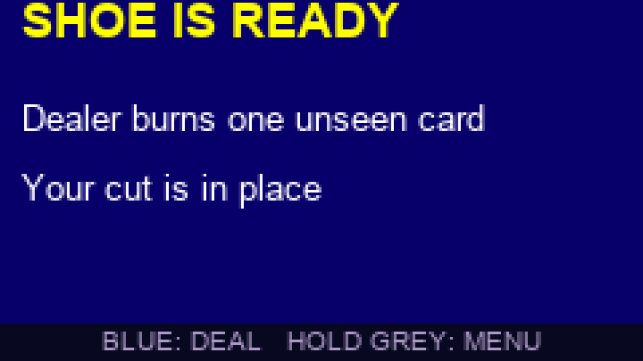](docs/media/screens/burn.png) |

*Blue twice into a hand — the actual Fast dealing sequence.*

## Why insurance appears automatically

The ace-up insurance prompt is an ordinary dealer-offered decision, not coaching; you need not request it first. [Palms' own guide, Insurance section](https://www.palms.com/blog/how-to-play-blackjack) describes that offer. Grey changes decline/take; Blue confirms the half-wager side bet if affordable, paying 2:1 profit on dealer blackjack. A ten-up peek has no insurance offer. Guide may additionally show a policy recommendation. The source supports this procedure, not a claim that our generic presets reproduce Palms' complete rules.

*The ace-up insurance choice appears on the table; Grey changes the choice and Blue confirms.*

In Guide, **INSURE?**, **DECLINE** and **YES $amount** remain visible at full size. Advice sits above them; Grey changes the highlighted choice and Blue confirms it. The recommendation does not choose for you.

| Ordinary insurance | Guide: Decline selected | Guide: Yes selected |
|---|---|---|
| 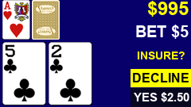 | 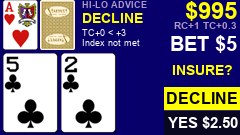 | 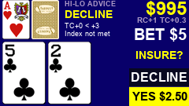 |

*0.11.3 native renderer, synthetic dealer ace of hearts and player 5♣/2♣. These show the same decision in different modes/selections.*

## Two buttons, different contexts

On StickS3, **Grey** moves and **Blue** selects. On Waveshare, **Right** is Grey and **Left** is Blue. A **tap** is a short press and release. A **hold** is about 0.85 seconds. Holds consume their release, so releasing after a menu/mode shortcut does not also hit, stand or select. Release both buttons after boot or a resume choice.

| Where you are | Grey tap | Blue tap |
|---|---|---|
| Player cut | Move cut position | Accept cut |
| Shoe-ready/burn notice | No ordinary action | Skip notice and deal |
| Your ordinary playing turn | Hit | Stand |
| Insurance offer | Change the highlighted choice | Submit the highlighted insurance choice |
| Ready/result table | Select wager | Deal next hand |
| List/menu | Move to next row, wrapping at the end | Select/toggle the row |
| Most multi-page reports | Next page/category/history item | Return to the parent named in the footer |
| Count answer | Decrease the number | Increase the number |
| Volume or brightness editor | Lower level | Raise level |

**Hold Grey** opens the unified menu. Holding it again while that menu is open returns to its saved context. In Sound/Display it returns to Settings; in Volume/Brightness it returns to the parent editor menu. Opening the unified menu from an unfinished exercise cancels that pending exercise; reopening does not recover a scored first answer as an unanswered question.

**Hold Blue** cycles **Off → Test → Coach → Guide → Off**, including from most menus. The exception is the Volume editor, where it auditions a deal sound. Changing mode does not execute a deferred Coach choice.

**Both buttons together submit only a count-answer quiz.** Wager and deviation exercises use menu choices and Blue. Outside a count quiz the chord has no play action, and both release tails are consumed.

The browser also supports **Left Arrow = Grey**, **Right Arrow = Blue**. Hold an arrow for the same shortcut. Focused buttons support Enter/Space. The canvas is the same 240×135 Rust interface; browser controls surround it.

The in-game **Controls** entry has four short pages. It teaches buttons and the mode-cycle shortcut; it does **not** contain the full Off/Test/Coach/Guide explanations below. Use this guide for those explanations.

| Tap controls on the device | Hold shortcuts and the four-mode cycle |
|---|---|
| [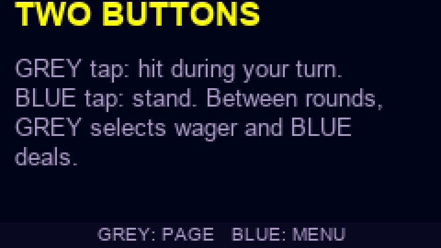](docs/media/screens/controls-00.png) | [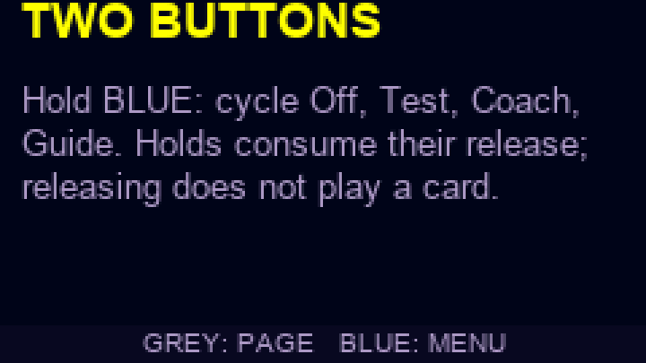](docs/media/screens/controls-02.png) |

## Reading the table

The ordinary table emphasizes your cards, dealer's exposed card, chips, wager, turn and result. It deliberately keeps computed totals and reports out of the main view. The dealer's face-down hole and unseen burn are not shown in card reviews or counted before exposure.

During the initial deal, watch the visible sequence before acting. With tablemates, their initial hands are shown in turn. Later draws also get a readable display, including cards that would otherwise be hidden by switching split hands or advancing to the dealer/result. Play, count questions and advice wait until required faces have been displayed. Fast speed shortens pacing without skipping these faces. Returning from a menu restarts the current face's readable dwell.

The result stays visible before Test's automatic review. The table's displayed hand and a multi-hand result may differ; **Review cards** lets you inspect the exposed hands in sequence. A temporary mode footer confirms a mode change.

[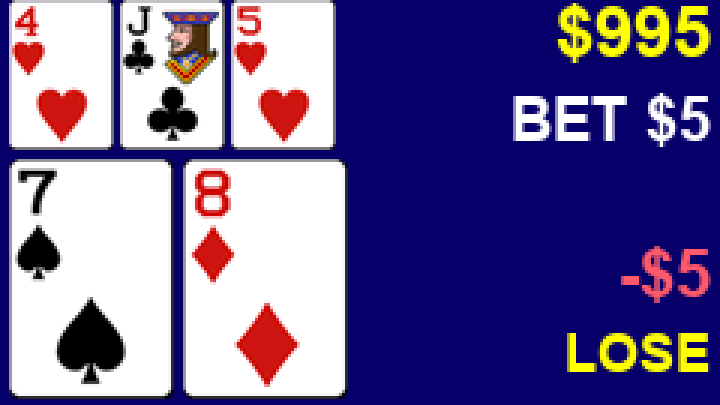](docs/media/screens/table-result.png)

*Cards, bankroll, bet and result stay on the ordinary table; reports remain behind the menu.*

### The main menu

Hold Grey. Legal **DOUBLE**, **SPLIT** and **SURRENDER** actions still appear first during a hand. The ordinary menu has seven entries:

| Entry | What it opens |
|---|---|
| Back to game | Return to the previous table/cut/review context. |
| Bet | Fixed or custom wager, between rounds. |
| Training | Mode, strategy, live counts, practice, progress and advice/EV. |
| Table | Table setup, current rules, shoe information and card review. |
| Session | Current results, reports, bankroll and starting a new session. |
| Settings | Display, Sound, Speed and opt-in Save/resume. |
| Help | Controls and explanations of Off, Test, Coach and Guide. |

A **>** opens another screen; toggles show their current value. Grey advances and wraps, Blue selects, and **hold Grey goes back one level** to the parent selection. Hold Grey from the main menu returns to play. Stick shows four full rows plus a faded next row; Waveshare shows six plus a preview. Neither uses “more below” text or a side scrollbar. Unavailable actions explain the restriction without changing the game.

[See every current menu on both devices](docs/MENUS.md). Older detailed feature screenshots below retain their historical version; use the current menu map for navigation.

## Choose teaching, policy and aids separately

These are independent settings:

| Setting | Question it answers | Where to change it |
|---|---|---|
| Mode | When should teaching or grading appear? | Training → Mode, or hold Blue. |
| Strategy | Which policy grades/recommends the action? | Training → Strategy, between rounds. |
| Count display | Should the table show RC or RC+TC? | Training → Live counts, with separate Normal play and Guide mode rows. |
| Action EV | What does the fixed mathematical model estimate? | Training → Advice & EV → Action EV or EV review. |

Choosing Hi-Lo does not automatically put a count on the ordinary table. Showing a count while Basic is selected does not turn Basic into Hi-Lo. EV is a separate model, not a count-driven prediction of the next card.

### Off: ordinary play

Off plays blackjack without recording live card-strategy decisions or pausing for automatic coaching. It is the normal boot mode. You can still inspect rules, manage wagers and open optional exercises. Off does not erase any lifetime scores.

Example: boot, Blue twice, Grey to hit or Blue to stand. Stay Off for an uninterrupted game.

[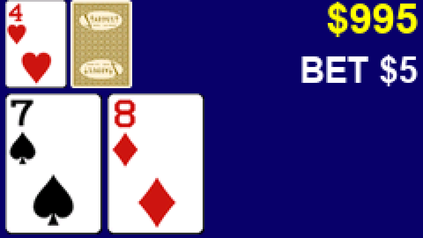](docs/media/screens/table-player.png)

*Off keeps the playing table free of advice and count aids by default.*

### Test: answer first, review after the hand

Test records the first legal choice at each decision, then lets the hand continue. Once the round settles and its final cards have been shown, **ROUND REVIEW** opens automatically when there are decisions to review. Its first page gives correct/errors/assisted counts and the round net; Grey steps through the original decisions; Blue returns to the table. Reviews have no answer deadline.

Example: choose an action without opening a hint. At the end, compare your choice with the policy's choice. A wrong choice that happened to win still remains a mistake in the policy score.

| 1. Automatic after-round summary | 2. Grey advances to the recorded decision |
|---|---|
|  | [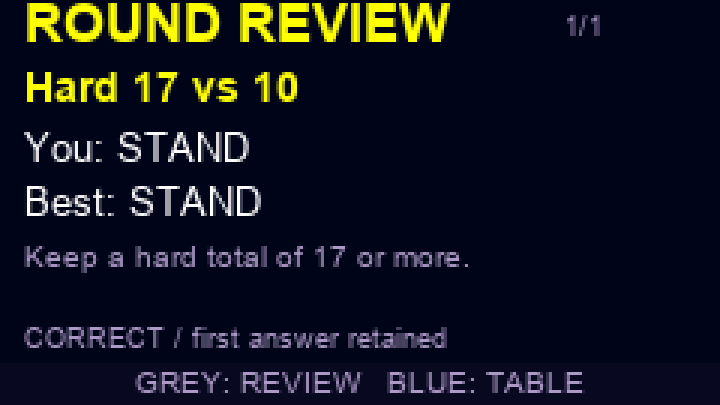](docs/media/screens/round-review-decision.png) |

### Coach: stop before a mistaken move is executed

Coach records your first choice. A policy mistake opens **COACH CHECK before acting**. It shows your choice, the recommended choice and a short explanation. Grey switches between **Play my choice** and **Use best action**; Blue executes the selected option. Correct choices continue normally.

Using the correction does not replace the original grade. This lets you learn without turning a first-attempt mistake into a correct score. A mode change can leave the check without playing its deferred move; it does not silently accept that move.

| 1. Original choice recorded before action | 2. Continue after choosing how to play |
|---|---|
|  | [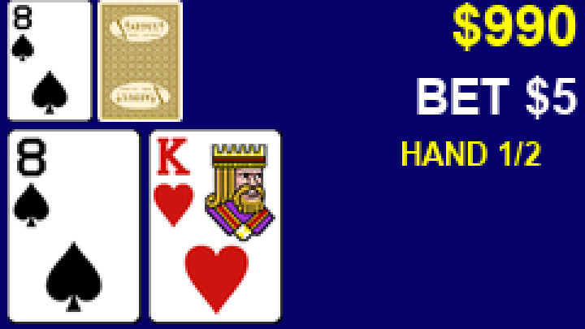](docs/media/screens/table-coach-continued.png) |

### Guide: learn with advice visible

Guide shows the recommended legal move and a short explanation on the table. Its default count aid is RC+TC. It records decisions as assisted when advice is visible, so it is a teaching mode rather than a way to raise unassisted accuracy.

Example: use Guide to learn how the current policy treats a soft hand, then switch to Test and hide normal count aids when you want an independent attempt.

*Guide places the Hi-Lo recommendation and reason beside the cards, with RC and TC above.*

### Basic and Hi-Lo strategies

**Basic** is the rule-specific basic-strategy policy. It responds to your exposed hand, the dealer upcard, the selected supported rules, legal actions and funding.

**Hi-Lo** starts with that Basic policy and applies the named published **BJA2018 Hi-Lo index policy**. It uses only exposed-card count information. Unindexed situations keep Basic; surrender/pair priority and action legality still matter. Insurance uses the published +3 threshold and actual affordability. This is a published policy implementation, not an exact optimizer for every remaining shoe composition.

Hi-Lo card tags are:

| Exposed face | Running-count change |
|---|---:|
| 2, 3, 4, 5, 6 | +1 |
| 7, 8, 9 | 0 |
| 10, J, Q, K, A | −1 |

**RC** is the sum of these tags for exposed faces. **TC** divides RC by physical undealt decks. The policy drops the fractional part **toward zero**: +5/2 = +2.5 uses +2; −1/2 = −0.5 uses 0. Some chart zero exceptions instead use strictly positive/negative RC. The decimal HUD and integer policy index can therefore differ. The unseen burn consumes physical cards without adding its hidden face to RC. See [count conventions and sources](docs/count-reference.md).

| Mode and Strategy are separate selections | A drill reference explains a particular count boundary |
|---|---|
| [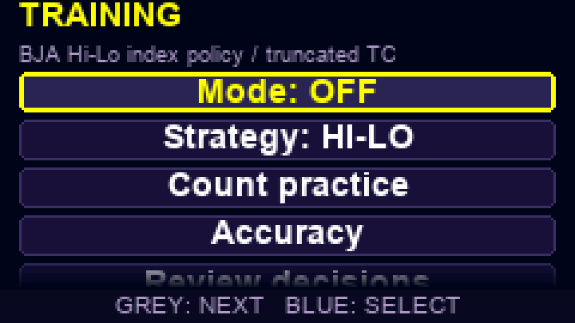](docs/media/screens/training.png) |  |

### Count display and assistance

**Training → Live counts** has separate **Normal play** and **Guide mode** rows. Each cycles **OFF → RC → RC + TC**. Normal play is shared by Off/Test/Coach; Guide starts RC+TC and normal starts OFF. You can change either preference without switching modes.

Assistance is sticky for the relevant decision/checkpoint. Visible Guide advice/counts, a hint, live EV, relevant count information and answer references can mark an attempt assisted. Opening strategy/EV history during an unresolved live decision also marks that decision assisted. Shoe information reveals count-related depth information. Viewing a result/reference at the same count checkpoint affects later attempts at that checkpoint; cancelling/reopening does not remove that exposure.

| Count info reveals the live checkpoint reference | Relevant help is retained as ASSISTED |
|---|---|
| [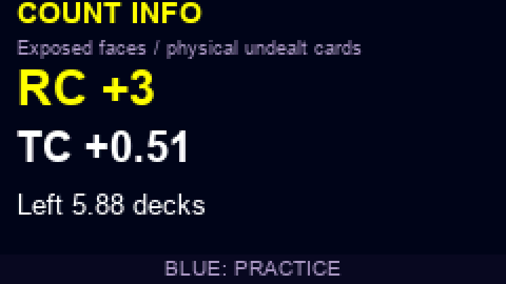](docs/media/screens/count-info.png) | [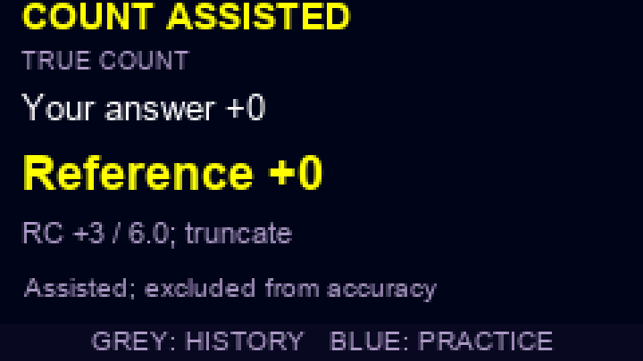](docs/media/screens/count-history.png) |

### Accuracy and first-answer rules

**Training → Accuracy** shows overall, hard totals, soft totals, pairs and insurance. Grey changes category; Blue returns. The display's **Correct X / Y** uses **Y = unassisted correct + unassisted errors**. Assisted attempts are a separate count, excluded from that denominator. With no unassisted answers, there is no measured unassisted accuracy yet.

The first accepted submission is retained with its original hand, rules, policy, count context, action, assistance and available EV snapshot. Invalid inputs do not consume a valid first answer. A correction, replay, mode change or later reference cannot overwrite it. Training Off does not invent graded card choices. Results and scores measure different things.

**Review decisions** shows retained choices, recommendations, explanations and assistance/correctness. **Hint** supplies advice during a fully revealed turn in a training mode and marks that decision assisted. Both return to Training with Blue. Histories retain the most recent 128 attempts per exercise model; cumulative saved counters continue beyond the retained history. The normal menus do not offer a lifetime-score reset.

| Unassisted accuracy and assisted totals are separate | Review retains the original choice and recommendation |
|---|---|
| [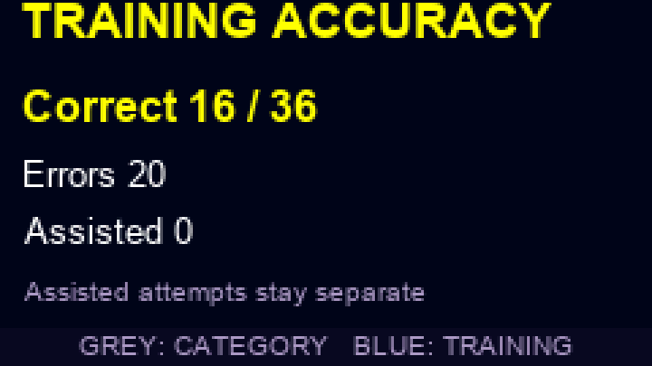](docs/media/screens/training-stats-00.png) |  |

## Count practice: three separate skills

Open **Training → Count practice** after the visible deal/draw sequence finishes. The questions freeze the current public checkpoint, rather than allowing the shoe to move while you answer. They do not reveal hidden faces.

| Entry | Task and scoring |
|---|---|
| Running count | Enter the RC you have kept. Exact integer match. |
| Decks left | Compare a one-deck reference stack with the remaining stack; answer in half-deck steps. Answers within **0.5 deck of the physical remainder** are accepted. |
| True count | Use your RC and the **given half-deck divisor shown on the question**, then truncate toward zero. The expected integer uses that stated divisor. |
| Show count info | Reveal current RC, decimal physical TC and exact decks left; this is assistance. |
| Count accuracy | Overall and the three individual skill totals. |
| Count history | Original answers, reference values and assisted/correct/mistake labels. |
| Return | Back to Training. |

On an answer screen, Grey decreases, Blue increases, and **both buttons submit once**. The result shows your answer and the reference; deck results show actual decks and tolerance, TC results show the conversion. Grey on the result starts another question of the same kind; Blue returns to Count practice.

The current two-button count question has no dedicated Help row. **Show count info** is available from the practice menu before starting/reopening a quiz, and its relevant assistance remains attached to that checkpoint. Holding Grey cancels to the menu. A new question token after cancellation does not erase checkpoint assistance or an already recorded answer.

Example: if the question gives 2.5 decks and you have kept RC +6, enter +2 because 6/2.5 = 2.4 and the fractional part is dropped. The count HUD can show a slightly different decimal when it uses the exact physical remainder.

*Choose the skill to check at the frozen public checkpoint.*

| Enter the RC you kept; both buttons submit | The result preserves your answer and the reference |
|---|---|
| [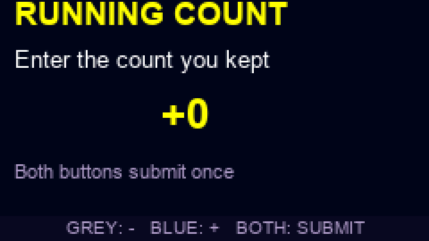](docs/media/screens/count-answer-running.png) |  |

| Deck estimation uses its own visual question | TC conversion supplies the divisor for this question |
|---|---|
| [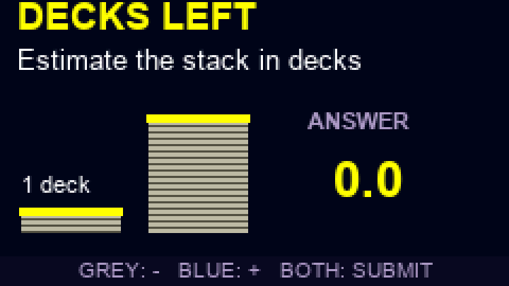](docs/media/screens/count-answer-decks.png) | [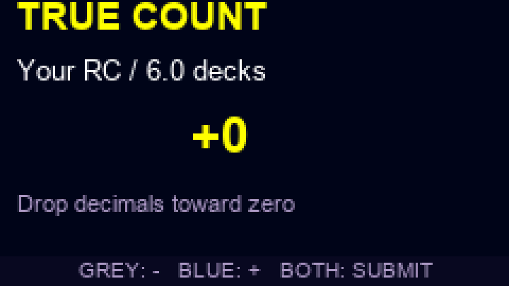](docs/media/screens/count-answer-true-count.png) |

## Wager practice: example ramp arithmetic

Open **Training → Wager practice** between rounds. This exercise is independent of the card-strategy mode and starts with **Predeal prompts: OFF**. Turn them on to receive a wager exercise before deals, or choose **Start checkpoint** for one attempt. **Manual play / no score** always remains available.

The default **EXAMPLE PRACTICE POLICY** uses the table minimum as one unit:

| Truncated TC | Example units | At a $5 minimum, before caps |
|---|---:|---:|
| 0 or below | 1 | $5 |
| 1 | 2 | $10 |
| 2 | 4 | $20 |
| 3 | 8 | $40 |
| 4 or more | 12 | $60 |

The raw amount is capped by table maximum and bankroll, then rounded down to the $5 step. If you cannot fund the minimum, the reference is **NO BET / REFILL**. This teaches the named ramp, limits and arithmetic; it is not claimed to be an optimal bankroll policy or a prediction of advantage.

On **CHOOSE PRACTICE WAGER**, use the Add/Subtract $5/$25 rows and select **Submit**. **Cannot fund minimum** submits the no-bet/refill answer. **Show example answer** reveals help and marks assistance. **Manual play / no score** bypasses grading for that deal; **Cancel checkpoint** leaves the exercise.

The result freezes your first submitted amount and the reference, including count band and caps. Blue **plays your chosen wager**, even if it was the wrong exercise answer; it does not silently substitute the reference. For a submitted no-bet answer, Blue offers the refill path. Grey opens result options: play/refill, edit manual wager, another checkpoint, practice menu or reference. A changed bankroll/rule/shoe checkpoint invalidates an old offer instead of applying it to a new context.

**Wager accuracy** has overall, TC≤0, TC1, TC2, TC3, TC4+ and refill categories. **Wager history** preserves the submitted amount and original example evidence. **Example unit ramp** lets you cycle each band's units among 1/2/4/8/12 between rounds. Edited ramps remain examples, and their original values are frozen with each attempt. Manual/no-score bets do not become correct or incorrect exercise answers.

| Choose a practice wager before submitting | Show example answer is explicit assistance |
|---|---|
| [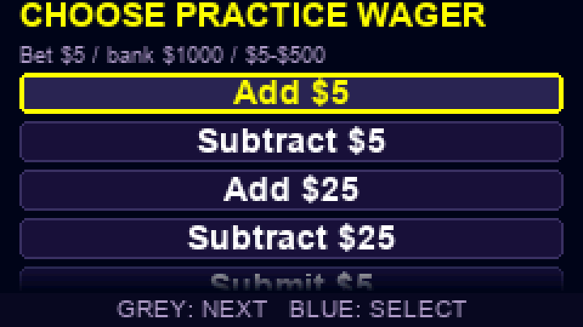](docs/media/screens/wager-answer.png) |  |

| The original submitted wager remains recorded | Play chosen wager uses that submitted amount |
|---|---|
| [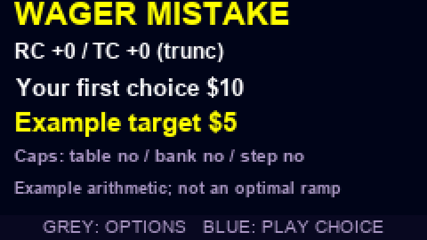](docs/media/screens/wager-result-mistake.png) | [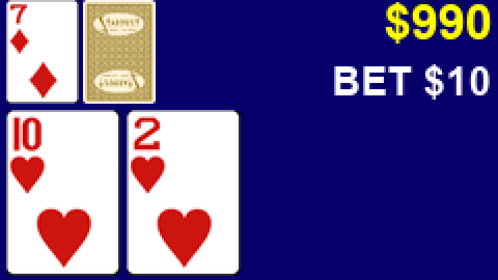](docs/media/screens/wager-played-choice.png) |

## Deviation drills: focused synthetic decisions

Open **Training → Deviation drills**. These are synthetic practice questions with an independent generator. They do not draw from or advance the live shoe. They always teach the named Hi-Lo index policy, even if live play is set to Basic or Off.

| Entry | Purpose |
|---|---|
| New question | Start a fresh original drill. |
| Target | Select one of 31 index targets or Mixed targets. |
| Boundary mix | Cycle MIXED, BELOW, AT or ABOVE a target boundary. |
| Rules | Cycle the supported practice profile independently of the live table. |
| Drill accuracy | Overall first/replay totals and individual target totals. |
| Replay missed | Replay a retained unassisted mistake; original accuracy is preserved. |
| Review attempts | Inspect retained original evidence. |
| Policy / original rules | Explain the named policy, conventions and fixed rule assumptions. |
| Return | Back to Training. |

The question shows your cards, dealer upcard, compact rule header and given RC/TC. Grey cycles legal action choices and **Original rules / count**, **Show reference (assisted)** and cancel options; Blue selects. Both-button submission is not used here. The three original-context pages supply fixed rules, count/divisor and funding/origin; given context is part of the question and is not itself help. Explicit reference viewing before answering marks the attempt assisted.

The reference compares Basic and policy actions, threshold direction, and legality/funding fallback. Results show your answer, the reference, threshold and original count. Grey starts another question; Blue returns to the drill menu. Review history has six pages per attempt: result, threshold reference, Basic/fallback, rules, count and funding/provenance. Replay counters are separate, so repeated practice cannot improve the original first-attempt record. Unsupported target/profile combinations are unavailable rather than replaced with a misleading question. Details: [deviation practice](docs/deviation-drills.md).

| Choose a legal move for the synthetic situation | Inspect the original context independently of the live shoe |
|---|---|
|  | [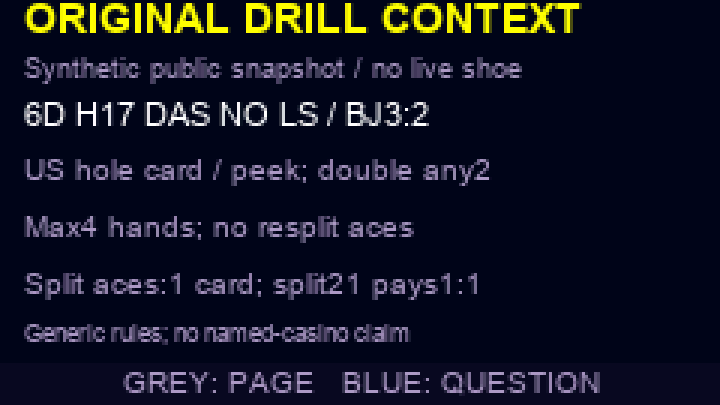](docs/media/screens/deviation-context-00.png) |

| Review the submitted choice and recommendation | Open the named index explanation |
|---|---|
| [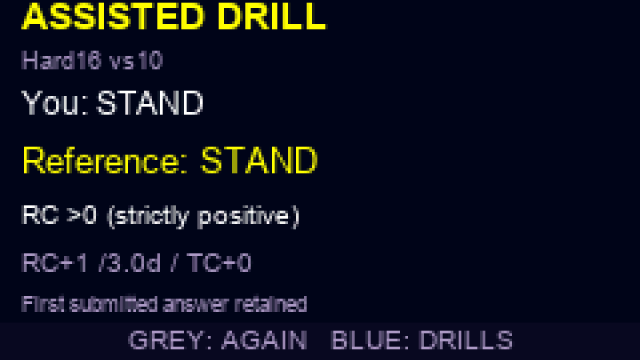](docs/media/screens/deviation-result.png) |  |

See missed-question replay and its separate totals

| Choose a retained missed drill | Replay totals stay separate from original attempts |
|---|---|
| [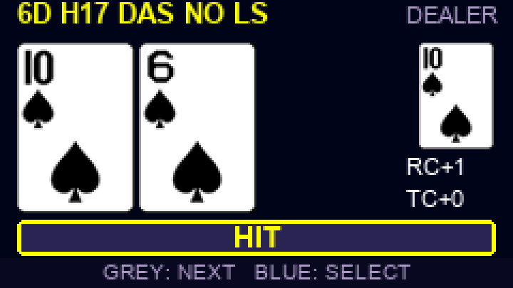](docs/media/screens/deviation-replay.png) | [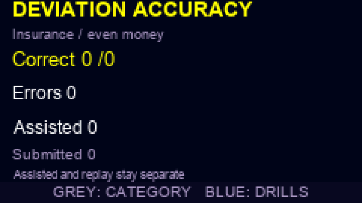](docs/media/screens/deviation-replay-stats.png) |

## Action EV and EV review

**Training → Action EV** is available during a fully revealed player/insurance decision. It lists legal actions; Grey advances actions and Blue returns. Opening it reveals a current-decision aid. **EV review** browses frozen snapshots from recorded decisions; Grey advances history.

The screen's **Infinite-deck replacement** model estimates expected **net** return per original wager, including its stated action/funding assumptions. It also converts units to an expected chip amount using that original wager. A value of −0.10 units at $5 means an average modeled net of −$0.50 for that action, not a guaranteed loss of fifty cents on this hand. Higher net EV is better within this model, even when all available values are negative.

EV does not inspect future order, the hidden dealer hole or an exact remaining-shoe composition. It does not turn a Hi-Lo count into composition-dependent EV. Some split values are unavailable or partial, and are labeled rather than filled with zero. A policy recommendation and the replacement model may differ because they answer different questions. EV snapshots are captured silently for eligible graded decisions; **viewing** an aid, rather than silent capture, is what marks assistance.

| Live Action EV labels the replacement model | EV review keeps the original snapshot and choice |
|---|---|
|  |  |

## Table setup, shoe and manual money controls

### Manual wagers and virtual funding

**Select wager** offers $5/$10/$25/$100, Custom wager and Return. Presets outside table limits are disabled. Custom wager has Add/Subtract $5/$25 and Accept amount. The engine still enforces legal limits and available chips. Between hands Grey opens wager selection; Blue deals with the selected amount.

**Session → Bankroll → Add $1000** adds a virtual deposit after the round. If there are too few chips for play, the refill screen offers the same funding. Funding is recorded separately from gambling net: a $1,000 deposit is not a $1,000 win.

**Session → New session** asks before starting at $1,000 with a fresh shoe and clearing session reports. It keeps the current table/seating, preferences and lifetime training scores. **Training → Progress → Reset training stats** separately clears hand/count/bet/deviation scores and learning histories, keeping the current bankroll, table, preferences and financial session reports. Both default to **Cancel**, work between rounds, and are different from one another. There is no cash-out/“Color up & leave” step in the normal menu.

| Choose a manual wager between rounds | Custom wager edits the amount before accepting |
|---|---|
|  | [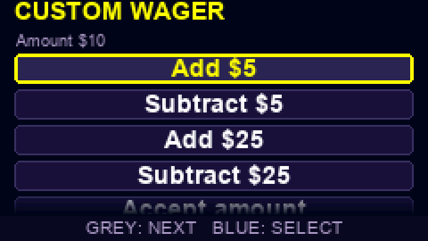](docs/media/screens/amount-edited.png) |

See the funding and session-completion screens

| Add virtual chips when needed | Finish the session and choose whether to start again |
|---|---|
| [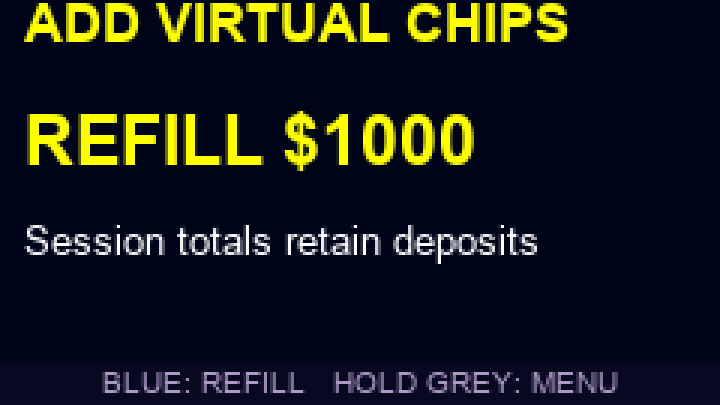](docs/media/screens/refill.png) | [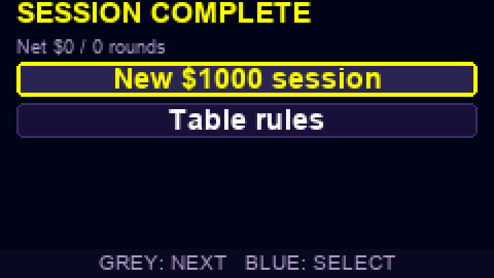](docs/media/screens/summary.png) |

### Table profile and rules

Open **Table → Table setup** between rounds. Choose a preset, edit minimum/maximum in $5 steps, choose dealer cut depth, then **Apply profile**. Pending edits do not silently change the active rules before application. Presets are:

| Menu preset | Difference from the default |
|---|---|
| 6 decks H17 / DAS / LS | Default six decks, dealer hits soft 17, double after split, late surrender, 3:2. |
| 6 decks S17 / DAS / LS | Dealer stands on soft 17. |
| 8 decks H17 / DAS / LS | Eight decks. |
| 6 decks H17 / no surrender | No surrender. |
| 6 decks H17 / no DAS | No doubling after a split. |
| 6 decks H17 / pays 6:5 | Natural blackjack pays 6:5. |

All are explicit generic training profiles, not a claim that a named casino currently offers them. They use US hole-card/peek rules, any-two-card doubling, up to four hands, one-card split aces and no resplitting aces. Unsupported variations such as European no-hole-card, early surrender and side bets are not configurable. See [complete table conditions](docs/TABLE_RULES.md).

| Edit the pending table profile | Choose one of the supported generic presets |
|---|---|
|  | [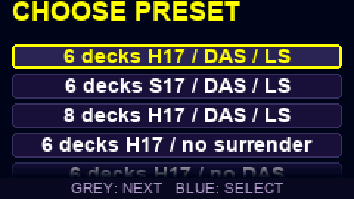](docs/media/screens/profile-preset.png) |

*Table rules displays the active conditions rather than silently assuming a casino preset.*

### Player cut, dealer marker and shoe information

The movable **player cut** rotates the shuffled stack. It does not set penetration or reveal an advantageous cut. The **dealer marker** determines when a new shoe is due: choose 50/60/70/75/80/85/90%, default 75%. Crossing it finishes the current round, then requests a new shuffle/cut. Seeing the cut screen again after play is expected.

The **SHOE IS READY** notice follows a cut and an unseen burn. **Shoe information** reports the shoe number, physical dealt/remaining count, marker and shuffle state. Its information can assist count/deck exercises and a live decision.

If a very deep round exhausts undealt cards, the documented simulation procedure shuffles only discarded cards, keeps held cards excluded, burns one unseen card and starts a new count epoch. The active round finishes, then a full shuffle follows. It does not quietly recycle held cards. See [shoe procedure](docs/extra-seats-engine.md).

| Moving the player cut changes its position | Dealer marker depth is a separate setting |
|---|---|
| [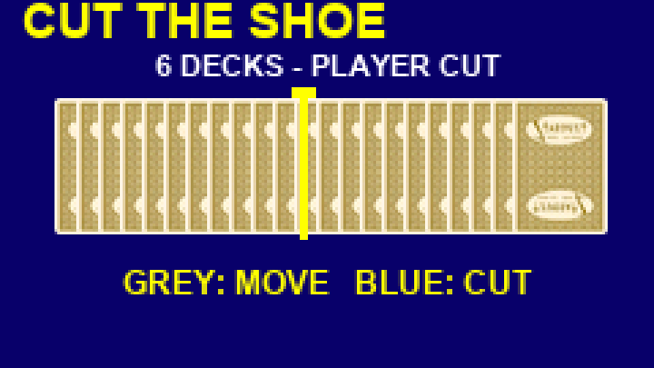](docs/media/screens/cut-moved.png) | [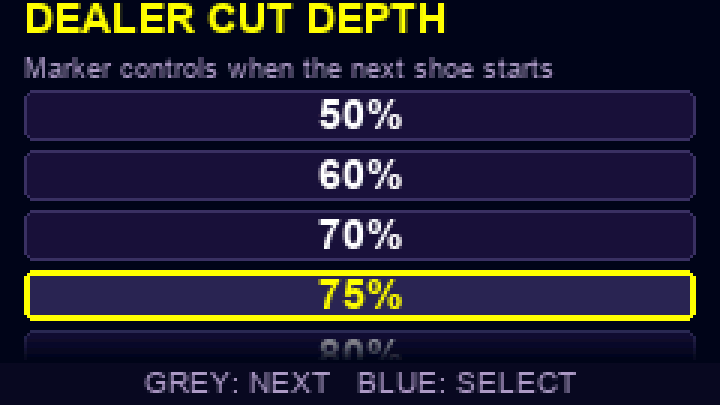](docs/media/screens/profile-depth.png) |

[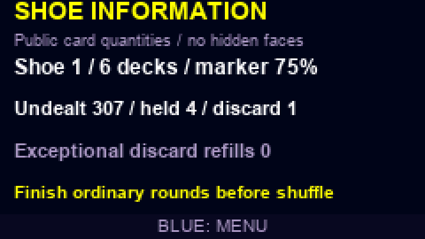](docs/media/screens/shoe-info.png)

*Shoe information reveals depth and shuffle information and therefore counts as an aid.*

### Optional tablemates and card reviews

**Table → Table setup → Other seats / your place** opens **TABLE SEATING**. Select 0–6 other seats, choose your place in the deal order, then **Apply seating / fresh shoe** between rounds. These virtual players use Basic strategy and flat minimum wagers; their chip ledgers are independent of yours. Zero extras keeps the shortest single-player flow.

Initial faces and later draws are presented before a dependent player decision/count question. The tablemate-turn display names seat/hand; it does not add a computed total to do your counting for you. **Review table cards** browses exposed hands across seats, including split hands and the exposed dealer cards. **Review cards** on the single-player path browses player/dealer groups, four cards per page. Grey advances; Blue returns. Reviews do not reveal a hidden hole or future cards.

*Other seats and their exposed cards are presented by the actual game.*

| Choose other seats and the controlled player position | Review exposed hands across the table |
|---|---|
|  |  |

## Session totals and analysis

**Session → Overview** shows current bankroll, rounds and net, with more totals on the next page. **Reports** opens session analysis. **Bankroll → Balance details** shows chips/deposits/cashouts/net, then win/loss/push/round counts and committed stakes. **Bankroll → Add $1000** adds virtual funds separately from gambling winnings. New session and Reset training stats have their own confirmations.

**Session analysis** describes the controlled player's settled rounds and first answers in the current session. It does not simulate future profit. Grey changes pages/categories/history inside a report; Blue returns to analysis.

| Analysis entry | What the pages mean |
|---|---|
| Session summary / dispersion | Summary money and stakes; round wins/losses/pushes and best/worst outcomes; observed mean/sample SD/streaks; a labeled IID-normal reference when enough observations exist. |
| Net history graph | Cumulative settled gambling net, excluding deposits and cashouts. |
| Settled round records | Recent immutable base wager, total stake/return and net/bankroll evidence. Double, split and insurance funding is included in round stake. |
| First-answer accuracy | Session-only live hard/soft/pair/insurance scores plus separate wager categories. Synthetic drills have their own totals. |
| Basic model EV differences | Frozen replacement-model differences for eligible **Basic-policy** first answers, separating assisted/unassisted samples and listing skips/unavailable evidence. |
| First-answer history | Original live decision evidence, policy, count, chosen/best action, assistance and available model comparison. Corrections do not rewrite it. |
| Assumptions / limits | Scope of money, policy grades, model comparisons and descriptive uncertainty. |
| Return to session | Back to Session totals. |

A new session clears session reports, not lifetime trainer counters. Recent round/first-answer rings retain 128 entries; cumulative session aggregates continue past those rings. Tablemates' chips and deposits/cashouts do not inflate gambling net. Negative realized net/mean is red, positive is green, zero is gold.

The displayed normal-reference band is available from 30 settled observations and is explicitly descriptive. It is not a confidence interval establishing blackjack advantage, a risk-of-ruin forecast or proof of independence. Finite-shoe rounds and changing wager sizes are dependent. Hi-Lo choices are excluded from the Basic EV aggregate: a correct count index must not be called an error merely because the separate replacement model values it differently. Partial/missing snapshots remain unavailable. If a money-ledger consistency check fails, prior analysis is labeled partial/stopped rather than inventing more report data. See [analysis definitions](docs/SESSION_ANALYSIS.md).

| Session totals is the entry point for reports | Funding and gambling net remain distinct |
|---|---|
| [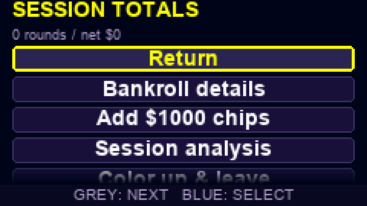](docs/media/screens/session.png) | [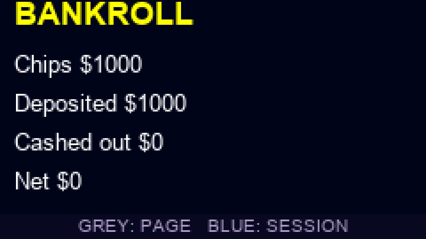](docs/media/screens/bankroll-00.png) |

| Inspect settled session totals | View cumulative settled net |
|---|---|
|  | [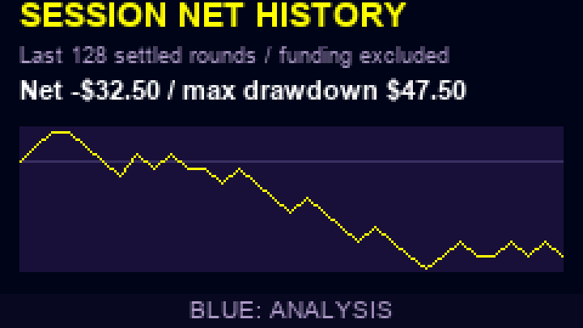](docs/media/screens/analysis-graph-00.png) |

| Session first-answer accuracy has its own pages | Hi-Lo choices are excluded from Basic model comparisons |
|---|---|
|  | [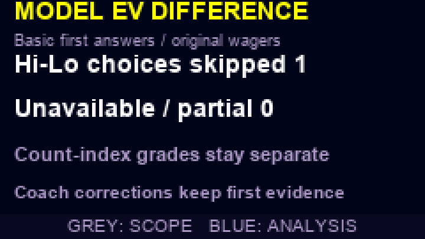](docs/media/screens/analysis-costs-hilo-unavailable.png) |

See the retained round and decision records

| Review individual settled rounds | Review original decision evidence |
|---|---|
|  | [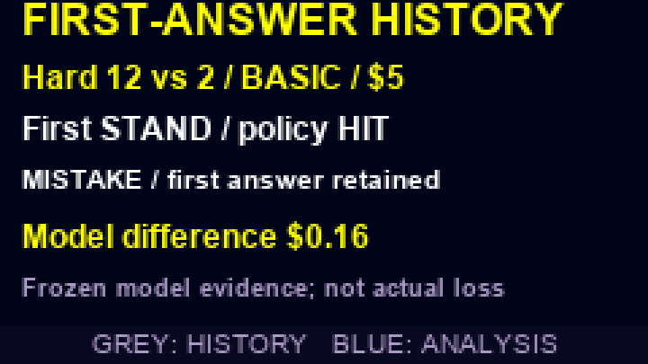](docs/media/screens/analysis-decisions-00.png) |

## Settings: sound, display, speed and resume

Settings contains **Display, Sound, Speed, Save/resume and Back**. Funding is under Session → Bankroll; live-count preferences are under Training → Live counts.

*Settings groups Display, Sound and Speed before the less frequently changed options.*

### Sound

**Sound** has **Master sound, Volume, Categories, Test sounds and Back**. Categories contains Menus/Cards/Results switches; Test sounds contains Deal/Win/Menu auditions. Master mute retains volume/category choices and also silences tests. Volume 0 is silent even with master on. Category toggles independently enable navigation/manual-chip sounds, deal/flip/shuffle sounds, and result/award sounds.

In **Volume**, Grey lowers and Blue raises. Steps are one percentage point through 0–10%, then multiples of 5 up to 100%. Both ends clamp. Hold Blue auditions a deal at that level; hold Grey returns to Sound. Named tests and the editor audition intentionally bypass category toggles so you can hear a category you disabled, but respect master mute and zero volume. They never turn sound on automatically and do not reveal a training answer. New installs default 20%.

| Master and category switches | Percentage volume with fine quiet steps |
|---|---|
| [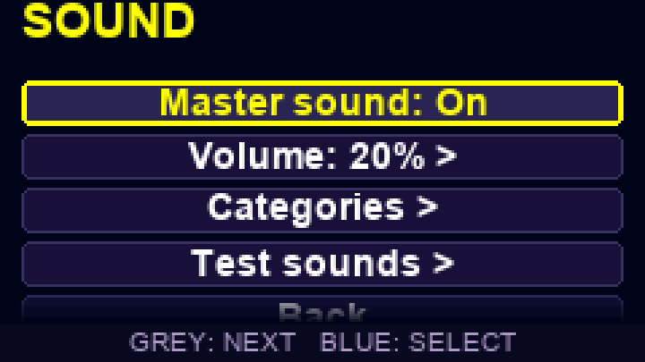](docs/media/menus/stick/sound.png) | [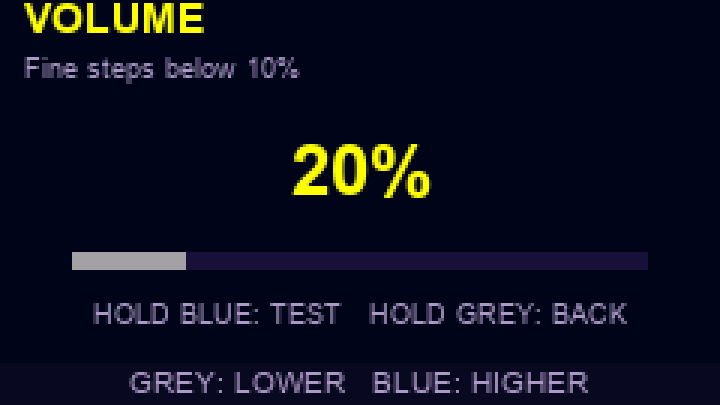](docs/media/screens/audio-volume.png) |

[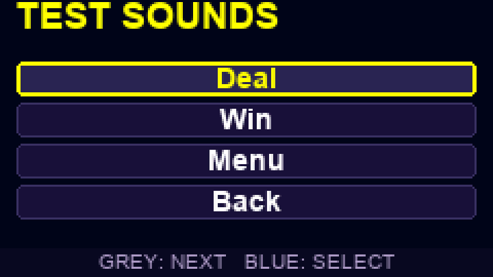](docs/media/menus/stick/test-sounds.png)

*Named deal, win and menu tests are available without changing training mode.*

### Display

Both models save your **Background** and **Card back** choices in **Settings → Display**. StickS3 offers Blue and Black. Waveshare offers Black, Blue, Green and Red. Select **Card back** to see the actual card as you cycle Gold, Red and Blue. Grey/Right cycles and Blue/Left returns to Display with the chosen back saved.

| StickS3 card-back preview | Waveshare card-back preview |
| :---: | :---: |
| [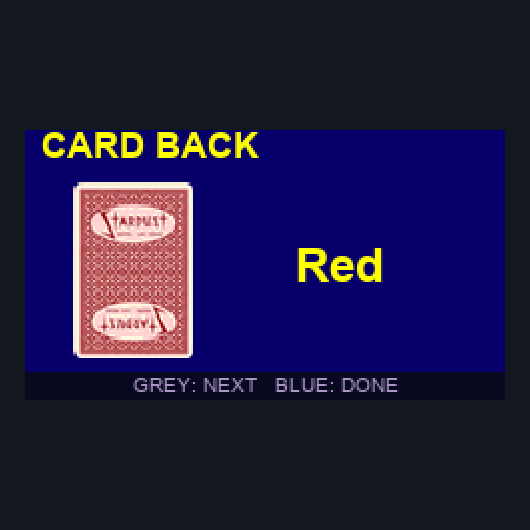](docs/media/compare/stick-card-back-red.png) | [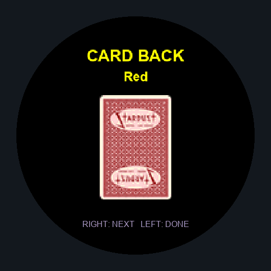](docs/media/compare/waveshare-card-back-red.png) |

In **Brightness**, Grey/Right lowers and Blue/Left raises the level by about 5 percentage points. The range runs from about 8% to 100%. Hold Grey/Right to return. **Screen** rotates the display 180°.

### Speed

**Speed** toggles only **Fast** or **Normal**. Fast is the new-install default and shortens automatic dealing/dealer/tablemate delays. It preserves the complete visible-card sequence and a minimum readable dwell. Reviews and count questions remain untimed, and hold thresholds are unchanged. Choose Normal if you want more time to watch each automatic stage. Sound/display controls do not change a grade.

| Fast is the new-install default | Normal remains selectable for slower automatic stages |
|---|---|
|  | [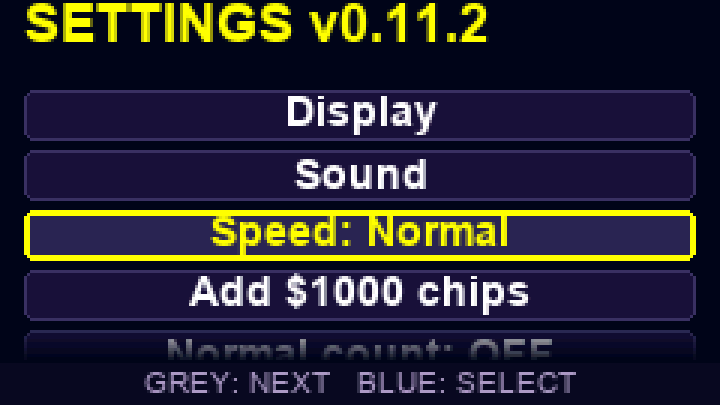](docs/media/screens/settings-normal-speed.png) |

### Count and resume preferences

**Training → Live counts** edits the two independent count preferences. **Settings → Save/resume** is opt-in and defaults OFF. See below before relying on it. [Detailed settings reference](docs/SETTINGS.md).

## Save and resume

Two kinds of state are deliberately separate:

| State | Ordinary preference/score save | Optional matching private checkpoint |
|---|---|---|
| Rules, settings, selected policy, exercise preferences | Retained | Retained with that session. |
| Lifetime training/count/wager/drill counters | Retained | Bound to verified public progress. |
| Current bankroll/hands/shoe/order/live mode | Fresh $1000/minimum/Off at normal boot | Restored only after explicit Resume. |
| Pending questions, help, first attempts, histories, session reports | Not part of the ordinary public packet | Restored as part of a complete valid checkpoint. |

With **Resume session OFF**, reboot starts the ordinary fresh game while retaining preferences and lifetime scores. Saved Basic remains Basic; new-install Hi-Lo is not forced onto it.

With it ON and a valid matching checkpoint available, the next boot offers **Resume saved session** or **Start a new session**. Blue selects the initially highlighted Resume; Grey changes to Fresh and Blue confirms. Release both buttons afterward. Only explicit Resume restores the exact live mode, original decisions/help, pending questions, bankroll, shoe and session reports. Restored visible-card stages receive a fresh readable dwell so a card cannot vanish before you see it.

Checkpoint work happens cooperatively during idle time, so **not every tap is immediately resumable**. Newer acknowledged play/progress can make an older private checkpoint unusable; the app refuses stale rollback rather than resurrecting an unanswered exercise or losing a newer grade. Starting a durable fresh session deliberately abandons the old one. The browser stores locally per profile/origin; clearing its site data removes that local data. Browser and device saves do not automatically synchronize.

| 1. Opt into private session resume | 2. Explicitly choose a saved session on the next boot |
|---|---|
| [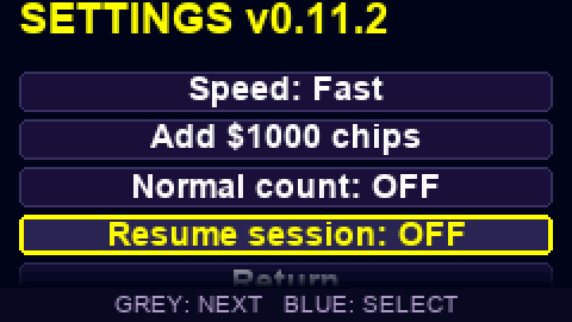](docs/media/screens/settings-resume.png) |  |

### Storage errors and UNSAVED

If a protected save cannot be verified, a **SAVE RETRY**/read-error choice blocks new feedback until storage is resolved. Retry repeats recovery/save work. **Start fresh without saving** is a deliberate RAM-only alternative: it discards the live pending question/outcome/history, starts Off/$1000/minimum with acknowledged preferences/scores when known, displays **UNSAVED**, and disables persistence/resume for the rest of that boot.

If the initial read failed, previous scores are explicitly unavailable; the app does not guess that they were zero on disk or overwrite unknown data. The RAM-only choice makes no journal writes or deletions. A later reboot may still offer the last valid durable checkpoint. Do not interpret UNSAVED as a successful save or a resumable session. See [resume and recovery details](docs/RESUME.md).

| Retry or explicitly abandon the pending session | RAM-only play is visibly marked UNSAVED |
|---|---|
| [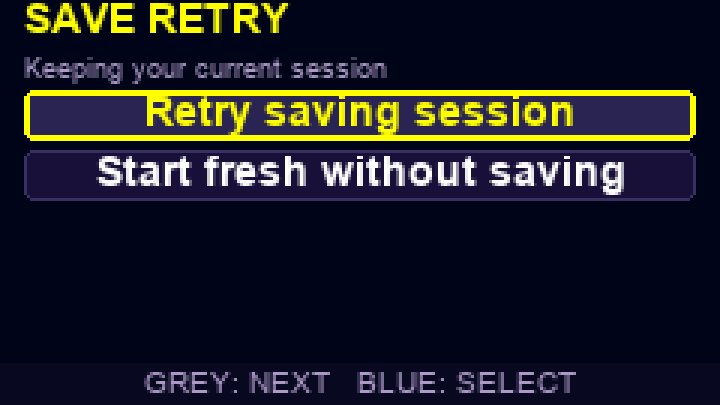](docs/media/screens/save-retry.png) | [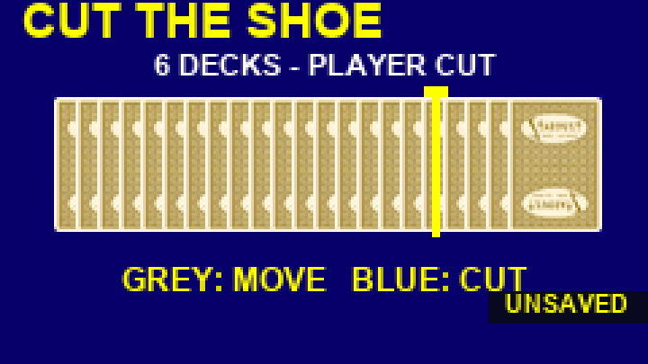](docs/media/screens/unsaved.png) |

See the separate read-error choice

*If saved data cannot be read, Retry and Start fresh without saving are explicit alternatives.*

## Three suggested training paths

1. **Check the app's policy:** finish a hand, select Basic or Hi-Lo under Training → Strategy, then use Guide to inspect recommendations. This selects a grading policy, not a count-display preference.
2. **Measure independent decisions:** choose Test and keep normal count display OFF. Play without Hint/EV, then inspect Round review. A losing correct action remains correct; a winning policy mistake remains an error.
3. **Separate counting skills:** use Normal speed if wanted and maintain RC through visible faces. Check Running count, then Decks left, then True count. Use Deviation drills for individual policy boundaries and Wager practice for the example ramp. Help is tracked separately from independent accuracy.

## Trainer glossary

| Term | Meaning here |
|---|---|
| RC / TC | Exposed-card running count / count per physical undealt deck. |
| Index / deviation | A named published count boundary that can change the Basic recommendation. |
| Truncate toward zero | Drop fractional digits: −2.8 becomes −2, not −3. |
| Policy | The selected Basic or named Hi-Lo recommendation/grading rules, distinct from an EV model. |
| Count HUD | Optional on-table RC or RC+TC display; separate from policy selection. |
| Checkpoint / token | A fixed exercise context / its one-use question identity; reopening cannot erase help or first answers. |
| Assisted | An attempt exposed to relevant advice/count/reference aids; tracked separately from unassisted accuracy. |
| First answer | The original accepted choice and evidence, retained through corrections/replays. |
| EV / unit | Expected net under a specified model / a multiple of original wager in EV, or table minimum in wager practice. |
| Replacement model | A model using the same card distribution for each draw, rather than the exact live remaining composition. |
| SD / drawdown | Observed result dispersion / fall from a previous cumulative-net peak. |
| Public save / private resume | Preferences and lifetime progress / the optional complete bound live-session checkpoint. |

For screen-by-screen pictures, see [Screen guide](docs/SCREEN_GUIDE.md). For primary chart provenance and technical assumptions, see [strategy sources](docs/strategy-sources.md), [count reference](docs/count-reference.md), [table conditions](docs/TABLE_RULES.md) and [session analysis](docs/SESSION_ANALYSIS.md). This virtual-chip trainer does not promise a casino advantage.

## Rules and model scope

The default is six decks, H17, DAS, late surrender, 3:2 and $5–$500 limits, with a 75% dealer marker. All presets and restrictions are explicit in [Table rules](docs/TABLE_RULES.md); they are generic profiles rather than claims about a named casino's current offering.

Cards come from a finite shoe. Advice follows Basic or the named BJA2018 Hi-Lo policy using exposed information. EV is a separate **infinite-replacement** model; it does not inspect the hidden shoe or turn a count into exact composition-dependent EV. The example wager ramp is not a universal optimal betting system. [Count policy](docs/count-reference.md) · [EV and analysis](docs/SESSION_ANALYSIS.md).

## Build and validation

The shared game, renderer and hardware application are Rust. See [Build and validation](docs/BUILD.md), [firmware details](firmware/README.md), and [installation/update instructions](docs/INSTALL.md). Installation guidance distinguishes tested app-only updates from a first-install partition migration; the app binary is not a universal full-device image.

## Releases and verification

The roadmap through 0.10 is implemented; later releases refine controls and defaults. [Release history](docs/ROADMAP.md) · [Current release](docs/RELEASE-0.12.2.md).

Automated native, mathematical, browser and firmware checks are recorded separately from actual-device checks. The 0.12.2 release adds a Black background on StickS3 and live card-back previews on both displays. Source-bound firmware builds, browser parity and scoped actual-device checks are recorded in the [current release](docs/RELEASE-0.12.2.md) and [validation evidence](validation/release-0.12.2.json). Earlier sound validation included user-confirmed audible deal and win cues on StickS3.

## Project and publication notes

This is an independent virtual-chip simulator, not an official casino or VideoPoker.com product. The current interface reuses source-derived materials with separate rights notices. Code metadata, inherited assets and their notices must not be treated as a single blanket license. [Attribution and asset provenance](docs/asset-provenance.md) · [Publication review](docs/PUBLISHING.md).

Private device dumps, player saves, local build caches and personal validation sessions are excluded. Third-party assets retain their owners' rights; publication does not turn those assets into MIT-licensed material. See the retained provenance and rights notices.
