# Screen guide — Stardust Blackjack 0.11.2

These are the original Stick-format examples. See the [native round-screen guide](WAVESHARE.md) for Waveshare 1.75C.

> These images reproduce the actual renderer using synthetic demonstration sessions. Third-party materials retain their separate rights and notices; see [attribution](THIRD_PARTY.md). Publication does not grant a blanket asset license.

This tour assumes you already play blackjack. It explains this app’s readouts, navigation and training behavior, rather than teaching the underlying game. All cards, bankrolls and scores here are **synthetic demonstrations**, created with deterministic seeds and actual native Rust rendering. No connected device, player save, private checkpoint or installed score was used. Independent walkthrough branches intentionally use different demo histories; values across pictures are not one player’s continuous ledger.

Every one of the 65 App screen types is represented, along with the shared recovery layouts and additional table states. The large previews are native 240×135 frames enlarged exactly 3× with nearest-neighbor scaling; each image links to its native PNG. Animated GIFs contain actual successive native frames and use a shared 256-color palette; the PNGs preserve exact decoded RGB565 colors.

For the complete illustrated feature manual use [Blackjack Trainer](../README.md).

## Contents

- [Table flow](#table-flow)
- [Training and decision evidence](#training-and-decision-evidence)
- [Count checkpoints](#count-checkpoints)
- [Wager exercises](#wager-exercises)
- [Synthetic Hi-Lo deviation drills](#synthetic-hi-lo-deviation-drills)
- [Table and shoe configuration](#table-and-shoe-configuration)
- [Session reports](#session-reports)
- [Settings and on-device controls](#settings-and-on-device-controls)
- [Save, resume and recovery](#save-resume-and-recovery)
- [Reproducing and auditing this gallery](#reproducing-and-auditing-this-gallery)

## First-hand flow

[Player cut](#player-cut) → [shoe-ready notice](#shoe-ready-notice) → [ordinary table](#ordinary-table-and-table-state-variants) → automatic dealer/result presentation → Blue for the next hand. Hold Grey for the unified menu whenever you need an app feature.

[](media/deal.gif)

*Synthetic example: Blue accepts a cut, Blue deals, and Fast mode presents the real card-reveal sequence. The animation loops; it is not a device recording.*

## Table flow

### Player cut

**Open:** Fresh session or the next shoe after the dealer marker.

[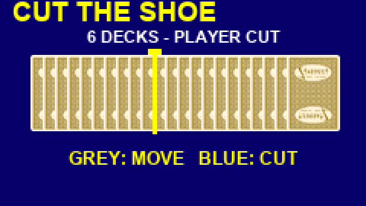](media/screens/native/cut.png)

The cut marker is positioned on the shuffled stack. The new-session defaults remain training Off, Hi-Lo selected, Fast pacing and a $5 wager. This is a player cut, separate from penetration.

**Buttons:** Grey moves the cut; Blue accepts. Hold Grey opens the menu.

**Use:** Move directly into the session without a buy-in setup sequence.

### Shoe-ready notice

**Open:** Accept the player cut.

[](media/screens/native/burn.png)

The notice confirms that one unseen burn card is excluded from the visible count. It does not reveal its face.

**Buttons:** Blue deals immediately; otherwise the paced notice ends automatically. Hold Grey opens the menu.

**Use:** Distinguish the burn notice from the next-hand decision state.

### Ordinary table and table-state variants

**Open:** Blue from the shoe-ready notice or between rounds.

[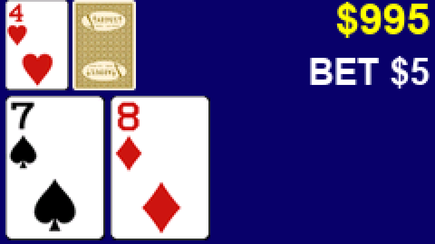](media/screens/native/table-player.png)

Large player cards, dealer upcard/back, available chips and current wager occupy the main table. The quiet Off-mode layout omits hand totals and optional aids. The same View also renders insurance, multiple hands, automatic dealer play and outcomes.

**Buttons:** During your decision Grey/Blue are the two main actions. Hold Grey exposes currently legal extra actions; between rounds Grey selects a wager and Blue deals.

**Use:** Keep the normal game readable while putting optional information behind explicit choices.

<details>
<summary>Insurance, extra actions and distinct result presentations</summary>

**Ace-up dealer offer; the highlighted Yes/No choice is separate from the ordinary turn.**

[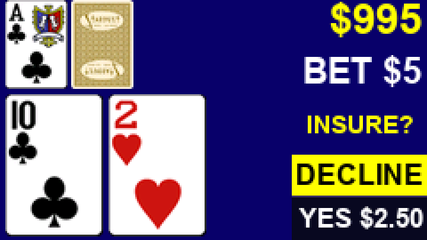](media/screens/native/table-insurance.png)

**Split-hand presentation and current hand context.**

[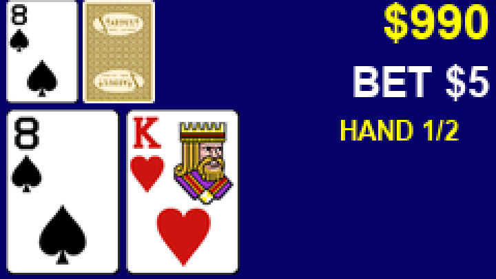](media/screens/native/table-split.png)

**The doubled commitment remains visible with the resulting draw.**

[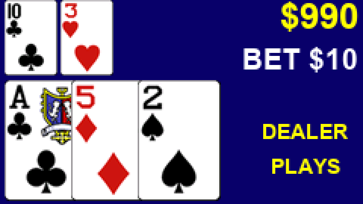](media/screens/native/table-double.png)

**Surrender settlement uses the same table presentation.**

[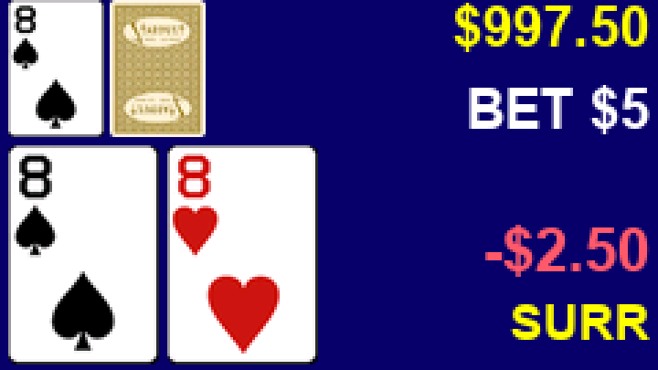](media/screens/native/table-surrender.png)

**Natural-blackjack result.**

[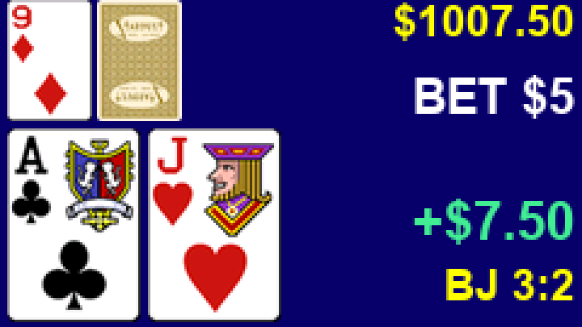](media/screens/native/table-blackjack.png)

**Push result.**

[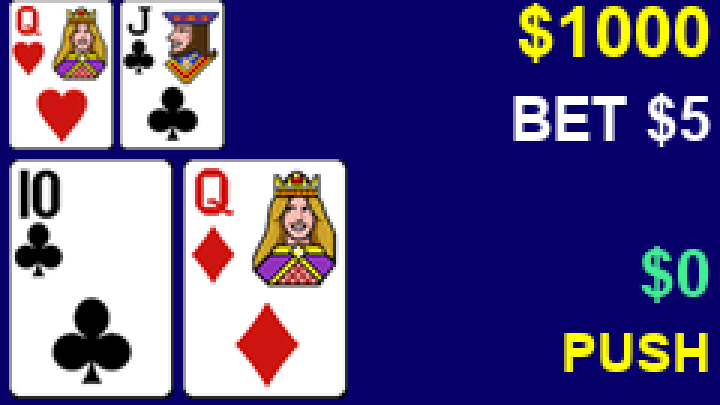](media/screens/native/table-push.png)

**Win result.**

[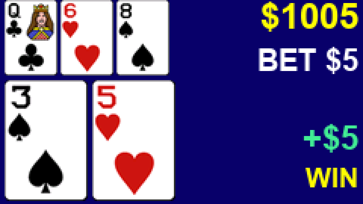](media/screens/native/table-win.png)

**Loss result.**

[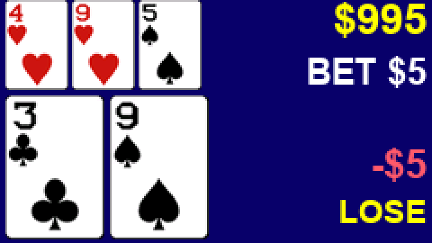](media/screens/native/table-loss.png)

**Bust result.**

[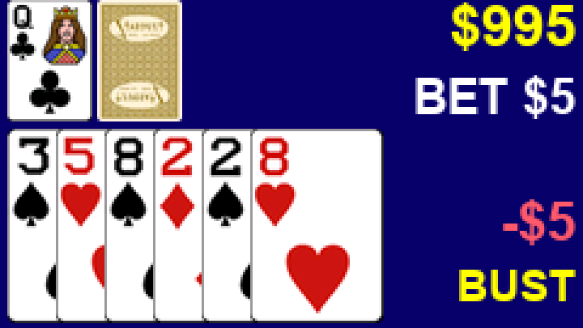](media/screens/native/table-bust.png)

</details>

### Unified menu and legal actions

**Open:** Hold Grey.

[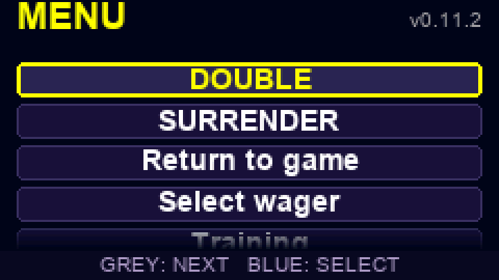](media/screens/native/menu.png)

Legal Double, Split and Surrender entries precede the ordinary menu when available. The version appears at the top right. Lists scroll, with a faded next row indicating more choices.

**Buttons:** Grey advances one row; Blue selects. Hold Grey returns to the interrupted game context.

**Use:** Reach wager, training, settings, reports and card review from one place.

### Select wager

**Open:** Menu → Select wager, or Grey between rounds.

[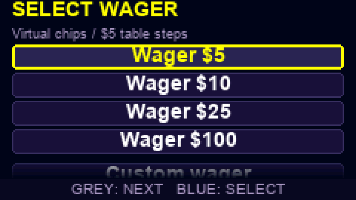](media/screens/native/wager.png)

Preset $5/$10/$25/$100 rows are enabled according to the current table limits. Custom wager opens the amount editor. This menu does not grade a wager-practice answer.

**Buttons:** Grey selects a row; Blue applies it or opens Custom wager. Return goes back to the table.

**Use:** Change the live virtual wager without enabling the optional exercise.

### Custom live wager

**Open:** Select wager → Custom wager.

[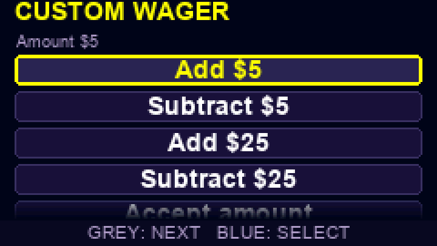](media/screens/native/amount.png)

The amount at the top changes in $5 or $25 steps, clamped to the active table limits. The selected amount is not applied until accepted.

**Buttons:** Grey advances the add/subtract/accept rows; Blue executes the highlighted row.

**Use:** Set a legal amount outside the four presets.

### Exposed-card review

**Open:** Menu → Review cards, with no extra seats.

[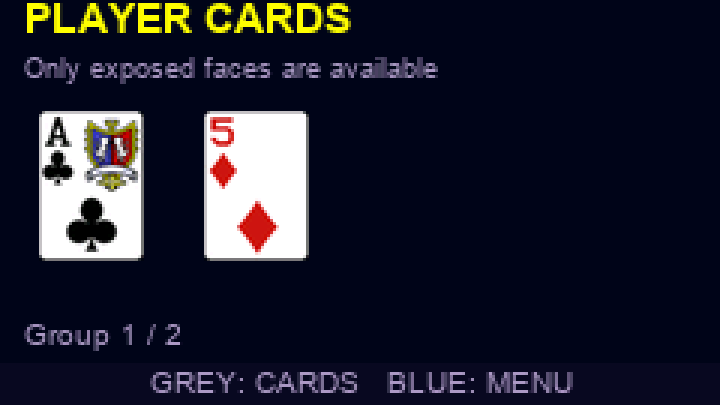](media/screens/native/cards.png)

The current player-hand group and dealer group can be reviewed in larger cards. The dealer hole remains excluded until revealed. Group/page indicators identify the displayed subset.

**Buttons:** Grey moves through card groups/pages; Blue returns to the menu.

**Use:** Revisit exposed faces without requesting hidden shoe or hole-card information.

### Player/tablemate hand review

**Open:** Menu → Review cards with extra seats, or Tablemates → Review cards.

[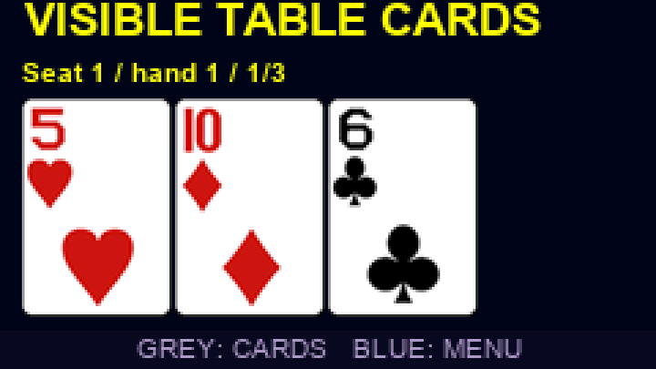](media/screens/native/seat-cards.png)

Seat and hand labels identify player/tablemate hands; long hands page in groups of four cards. Other seats have separate virtual chips and do not change the player bankroll ledger.

**Buttons:** Grey advances exposed-hand pages; Blue returns to the menu.

**Use:** Follow a multi-seat round without crowding every hand onto the live table.

### Contextual notice

**Open:** Request something unavailable in the present context.

[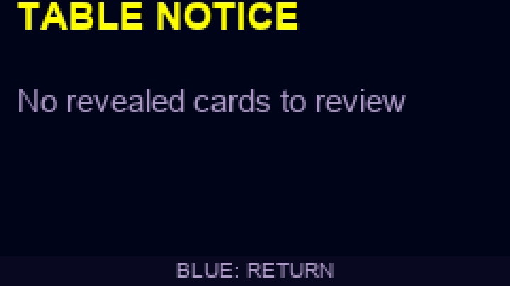](media/screens/native/notice.png)

A short reason explains why an operation was refused. This example requests card review before any hand exists; other notices cover unfinished rounds, unavailable advice or changed checkpoints.

**Buttons:** Blue returns to the relevant previous screen.

**Use:** Keep the current game intact when a request cannot be performed.

### Add virtual chips

**Open:** Session totals → Add $1000 chips, or an unfunded next hand.

[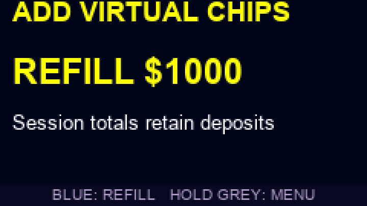](media/screens/native/refill.png)

The refill is a deposit in the session ledger. It is not counted as gambling profit. It is available only at a suitable completed-round checkpoint.

**Buttons:** Blue adds $1,000; hold Grey opens the menu.

**Use:** Continue a virtual session while retaining accurate funding and net totals.

### Color up confirmation

**Open:** Menu → Color up & leave, or Session totals.

[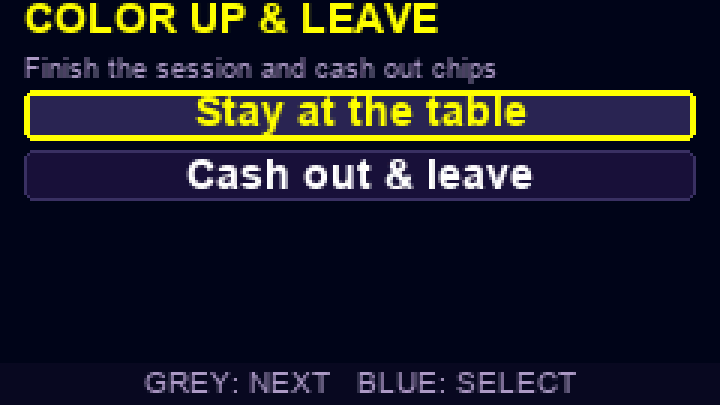](media/screens/native/leave.png)

The confirmation separates staying at the table from cashing out the session balance. Active rounds must finish first.

**Buttons:** Grey changes the choice; Blue confirms it.

**Use:** Avoid accidentally closing a running session.

### Completed session

**Open:** Confirm Cash out & leave.

[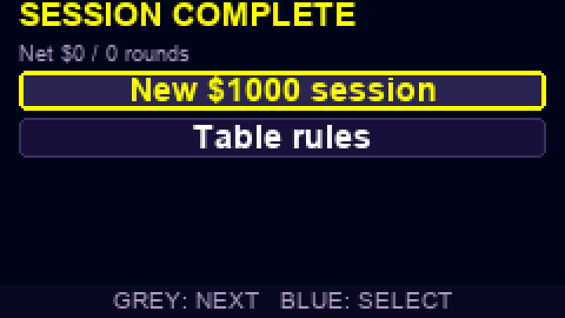](media/screens/native/summary.png)

The completed-session header shows gambling net and settled-round count. A new session resets session reports and chips while retaining lifetime training totals/preferences.

**Buttons:** Grey chooses New $1000 session or Table rules; Blue selects.

**Use:** End a session explicitly and distinguish session statistics from lifetime accuracy.

## Training and decision evidence

### Training menu

**Open:** Menu → Training.

[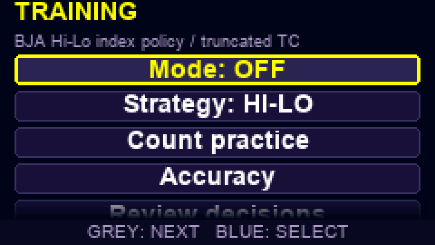](media/screens/native/training.png)

Mode and strategy are separate choices. Fresh installations select Hi-Lo, but training starts Off. The menu also reaches count practice, accuracy, reviews, Action EV, hints, wager practice and deviation drills.

**Buttons:** Grey advances; Blue selects. Hold Blue normally cycles Off → Test → Coach → Guide.

**Use:** Choose when feedback appears and which policy evaluates decisions.

**Modes:** Off keeps ordinary play quiet; Test reviews after the round; Coach pauses incorrect first choices before acting; Guide displays inline advice. Changing mode does not change the selected Basic/Hi-Lo policy or table rules.

**Guide-mode table:** this separate real native frame shows the fresh Hi-Lo policy, advice and its Guide count display. Visible advice/counts are assistance; Off’s ordinary table remains quiet.

[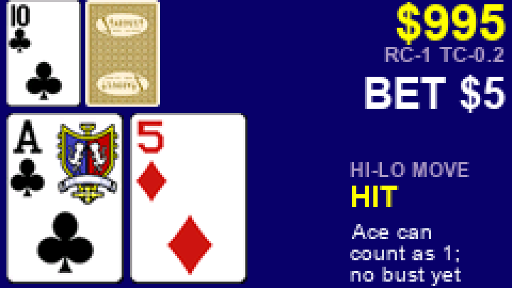](media/screens/native/table-guide.png)

### Requested decision hint

**Open:** Training → Hint during a fully revealed decision.

[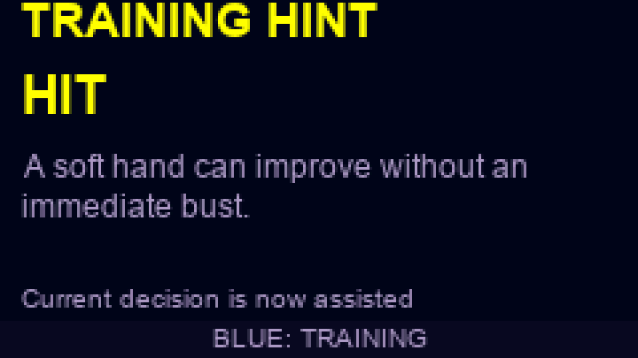](media/screens/native/hint.png)

The selected policy supplies an action and short explanation. Viewing it marks that decision assisted, even if the aid is later hidden.

**Buttons:** Blue returns to Training; hold Grey opens the unified menu.

**Use:** Ask for help explicitly rather than displaying continuous advice.

### Coach mistake pause

**Open:** Coach mode after an incorrect first choice.

[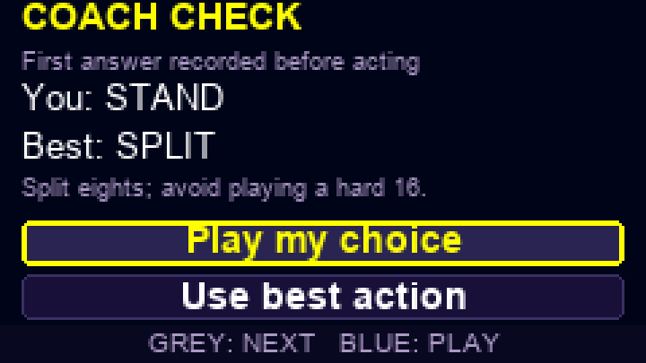](media/screens/native/coach-check.png)

Your original choice, recommended action and explanation appear before the move is carried out. The first answer has already been recorded and cannot be repaired by choosing the recommendation.

**Buttons:** Grey switches between Play my choice and Use best action; Blue continues.

**Use:** Understand the policy disagreement while preserving first-answer evidence.

### Automatic Test round review

**Open:** A settled round played in Test mode.

[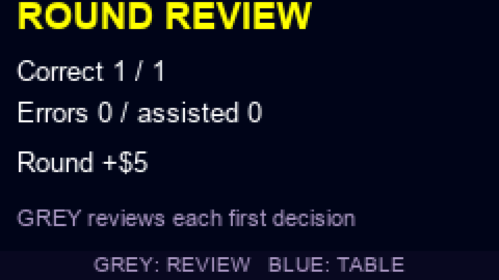](media/screens/native/round-review.png)

The summary separates correct, error and assisted decisions and shows the round net. Further pages review the original decisions. This screen is untimed.

**Buttons:** Grey advances the summary/decision pages; Blue returns to the table.

**Use:** Review a whole round after play without coaching each decision in advance.

<details>
<summary>Additional captured pages / variants (1)</summary>

- [round-review-decision](media/screens/round-review-decision.png) · [native 240×135](media/screens/native/round-review-decision.png)

</details>

### Lifetime play accuracy

**Open:** Training → Accuracy.

[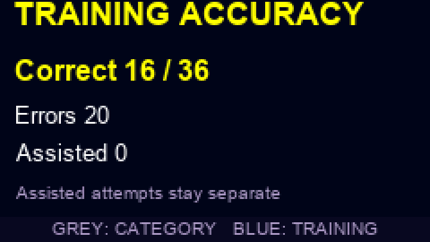](media/screens/native/training-stats-00.png)

Overall, hard-total, soft-total, pair and insurance pages separate first-answer outcomes and assistance. These are generated demo totals, not device scores.

**Buttons:** Grey changes category; Blue returns to Training.

**Use:** Locate categories worth practicing without combining assisted and unassisted performance.

<details>
<summary>Additional captured pages / variants (4)</summary>

- [training-stats-01](media/screens/training-stats-01.png) · [native 240×135](media/screens/native/training-stats-01.png)
- [training-stats-02](media/screens/training-stats-02.png) · [native 240×135](media/screens/native/training-stats-02.png)
- [training-stats-03](media/screens/training-stats-03.png) · [native 240×135](media/screens/native/training-stats-03.png)
- [training-stats-04](media/screens/training-stats-04.png) · [native 240×135](media/screens/native/training-stats-04.png)

</details>

### Original decision history

**Open:** Training → Review decisions.

[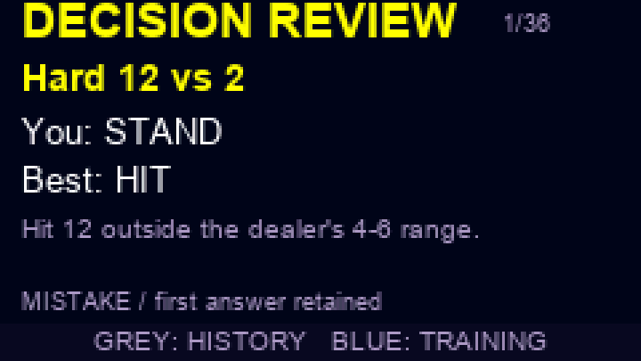](media/screens/native/training-review.png)

The review retains the visible decision context, your first action, the policy recommendation and explanation. Reopening a decision does not regrade it.

**Buttons:** Grey moves through recorded decisions; Blue returns to Training.

**Use:** Audit the evidence behind an accuracy result.

### Action EV inspection

**Open:** Training → Action EV during a fully revealed legal decision.

[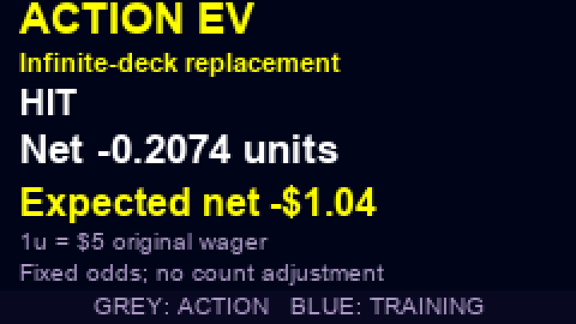](media/screens/native/action-ev-00.png)

Each legal action has expected net units per original wager and the corresponding example money value. Values use the documented infinite-replacement model; split bounds/availability remain explicit. The screenshot uses Basic for this model example.

**Buttons:** Grey cycles legal actions; Blue returns to Training.

**Use:** Compare modeled alternatives without consulting the hidden live shoe. Viewing advice marks assistance.

<details>
<summary>Additional captured pages / variants (2)</summary>

- [action-ev-01](media/screens/action-ev-01.png) · [native 240×135](media/screens/native/action-ev-01.png)
- [action-ev-02](media/screens/action-ev-02.png) · [native 240×135](media/screens/native/action-ev-02.png)

</details>

### Recorded decision EV review

**Open:** Training → EV review.

[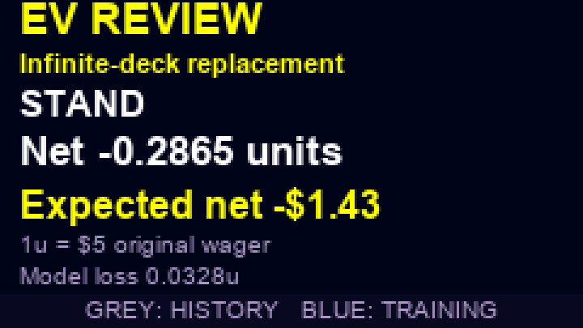](media/screens/native/ev-review.png)

Available first-decision model values can be revisited alongside the original choice. Missing or skipped model evidence remains unavailable, not zero loss.

**Buttons:** Grey advances recorded decisions; Blue returns to Training.

**Use:** Inspect a model difference separately from the hand’s realized win/loss.

## Count checkpoints

### Count practice menu

**Open:** Training → Count practice.

[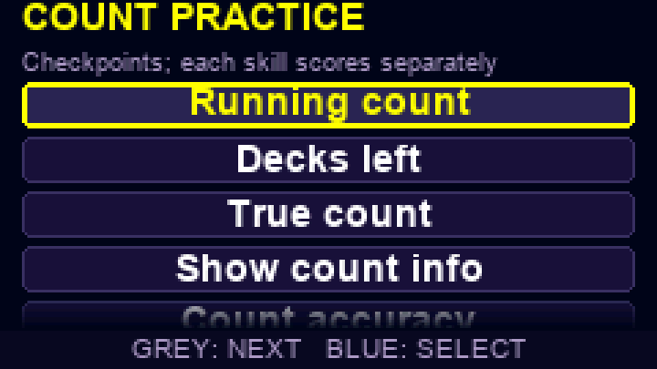](media/screens/native/count-practice.png)

Running count, deck estimate and true-count conversion are separate exercises. Count information, accuracy and history are separate rows. A checkpoint uses currently exposed faces and physical undealt-card quantities.

**Buttons:** Grey advances; Blue starts the selected exercise or opens a report.

**Use:** Practice a specific counting skill independently from action grading.

### Count-answer editors

**Open:** Count practice → Running count / Decks left / True count.

[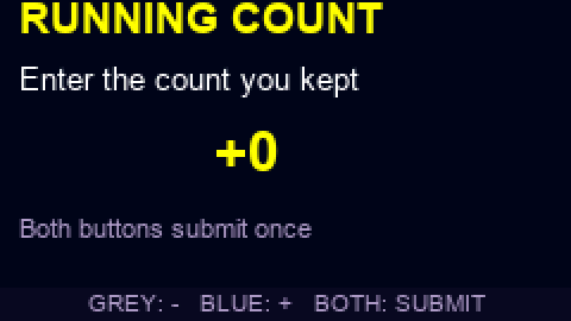](media/screens/native/count-answer-running.png)

RC uses a signed entry, the deck estimate uses half-deck steps beside a reference stack, and TC conversion states its divisor. References are gated until grading; the current two-button editor has no dedicated Help row.

**Buttons:** Grey decreases; Blue increases; both together submit once. Hold Grey cancels to the menu.

**Use:** Commit one original answer at a stable visible-card checkpoint.

<details>
<summary>Additional captured pages / variants (2)</summary>

- [count-answer-decks](media/screens/count-answer-decks.png) · [native 240×135](media/screens/native/count-answer-decks.png)
- [count-answer-true-count](media/screens/count-answer-true-count.png) · [native 240×135](media/screens/native/count-answer-true-count.png)

</details>

### Count result and reference

**Open:** Submit a count answer with both buttons.

[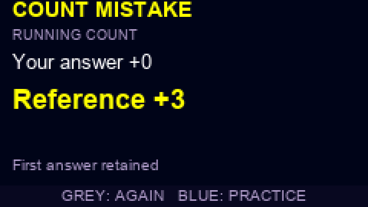](media/screens/native/count-result-running.png)

The result compares your first entry with the checkpoint reference. Deck estimates state their tolerance; TC shows the stated conversion and truncation convention. Assistance is explicitly labeled.

**Buttons:** Grey starts another exercise of that kind; Blue returns to Count practice.

**Use:** Check the specific counting error without changing the original grade.

<details>
<summary>Additional captured pages / variants (2)</summary>

- [count-result-decks](media/screens/count-result-decks.png) · [native 240×135](media/screens/native/count-result-decks.png)
- [count-result-true-count](media/screens/count-result-true-count.png) · [native 240×135](media/screens/native/count-result-true-count.png)

</details>

### Lifetime count accuracy

**Open:** Count practice → Count accuracy.

[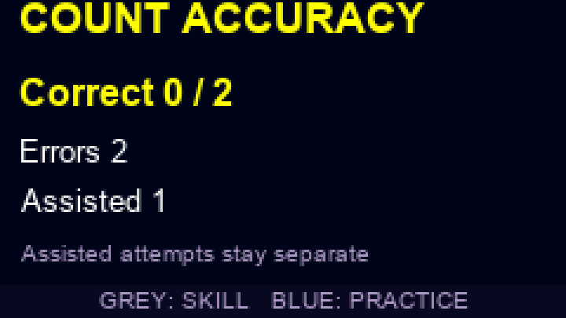](media/screens/native/count-stats-00.png)

Overall, RC, deck-estimate and TC pages keep count exercises separate from play-action scores. Assisted attempts are excluded from unassisted accuracy.

**Buttons:** Grey changes skill page; Blue returns to Count practice.

**Use:** Identify whether recall, estimation or conversion needs attention.

<details>
<summary>Additional captured pages / variants (3)</summary>

- [count-stats-01](media/screens/count-stats-01.png) · [native 240×135](media/screens/native/count-stats-01.png)
- [count-stats-02](media/screens/count-stats-02.png) · [native 240×135](media/screens/native/count-stats-02.png)
- [count-stats-03](media/screens/count-stats-03.png) · [native 240×135](media/screens/native/count-stats-03.png)

</details>

### Count first-answer history

**Open:** Count practice → Count history.

[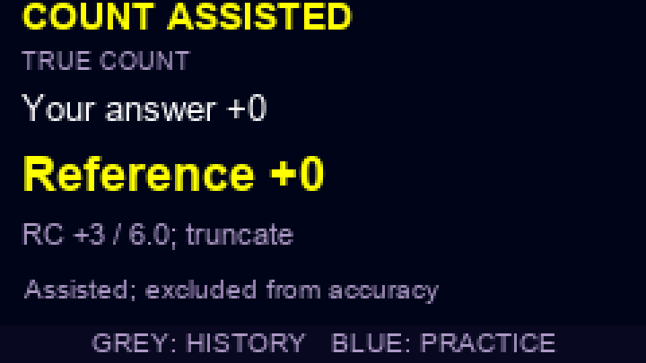](media/screens/native/count-history.png)

Each page retains the original answer, reference and assistance status. Inspecting evidence that still matches the live checkpoint is itself an aid.

**Buttons:** Grey advances history; Blue returns to Count practice.

**Use:** Review recorded answers without reopening their score.

### Explicit count information

**Open:** Count practice → Show count info.

[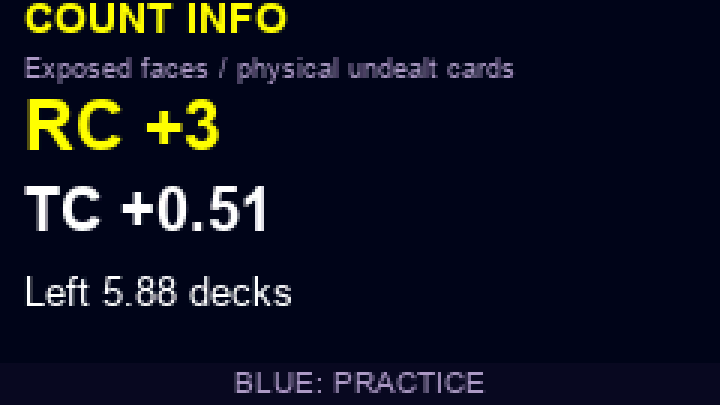](media/screens/native/count-info.png)

RC, physical TC, decks remaining and observed-card quantities are revealed explicitly. This is information about exposed faces and physical remaining cards, not a hidden-card list. Viewing it marks relevant assistance.

**Buttons:** Blue returns to Count practice.

**Use:** Inspect the counter or establish a reference before a new assisted exercise.

## Wager exercises

### Optional wager-practice menu

**Open:** Training → Wager practice.

[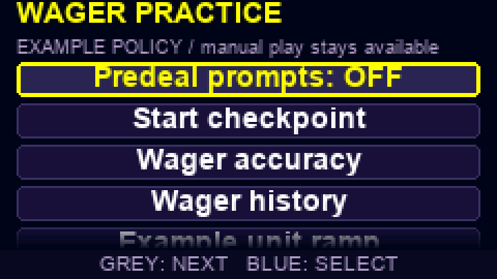](media/screens/native/wager-practice.png)

Predeal prompts default Off. Start checkpoint launches an exercise without requiring automatic prompts; accuracy, history and the example unit ramp are separate options.

**Buttons:** Grey advances; Blue selects or toggles prompts at a completed-round checkpoint.

**Use:** Keep ordinary manual betting available while practicing a named example policy.

### Frozen predeal wager answer

**Open:** Wager practice → Start checkpoint, or an enabled predeal prompt.

[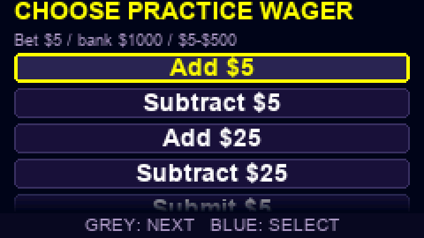](media/screens/native/wager-answer.png)

The header states proposed amount, available bankroll and table limits. Options adjust the amount, submit it, report an unfunded minimum, reveal the example, use manual play without a score, or cancel. No cards are dealt first.

**Buttons:** Grey selects the row; Blue adjusts/submits/opens the chosen option.

**Use:** Record one wager decision using the original count, rules and funding context.

### Example wager reference

**Open:** Wager answer → Show example answer.

[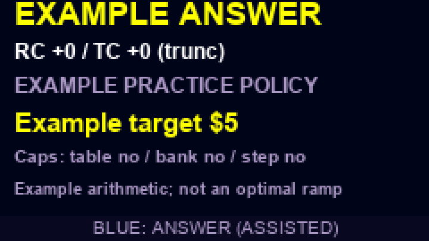](media/screens/native/wager-help.png)

The reference shows count band, example ramp and applicable caps. Revealing it before answering makes the attempt assisted. It is an example spread, not a universally optimal bet.

**Buttons:** Blue returns to the answer editor.

**Use:** Understand how the exercise applies its stated policy and limits.

### Wager first-grade and follow-up options

**Open:** Submit the practice wager.

[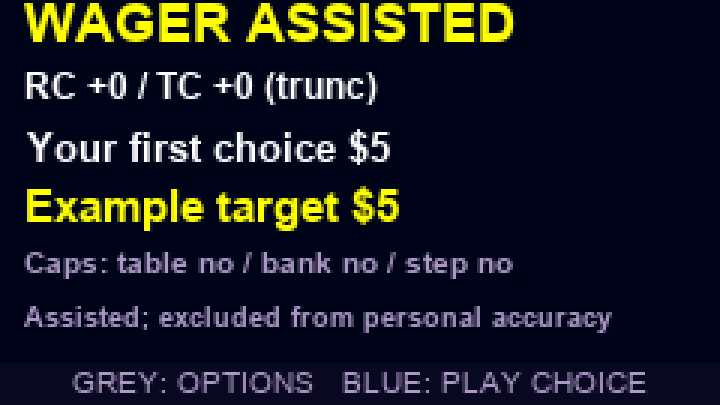](media/screens/native/wager-result.png)

The original amount and example answer are retained. Blue can play the submitted choice even if it was marked wrong. The options page offers manual betting, another checkpoint or practice navigation.

**Buttons:** Grey opens/cycles options; Blue plays the first choice or selects the highlighted follow-up.

**Use:** Separate grading from the actual amount chosen for the next hand.

<details>
<summary>Additional captured pages / variants (2)</summary>

- [wager-result-options](media/screens/wager-result-options.png) · [native 240×135](media/screens/native/wager-result-options.png)
- [wager-result-mistake](media/screens/wager-result-mistake.png) · [native 240×135](media/screens/native/wager-result-mistake.png)

</details>

### Wager accuracy categories

**Open:** Wager practice → Wager accuracy.

[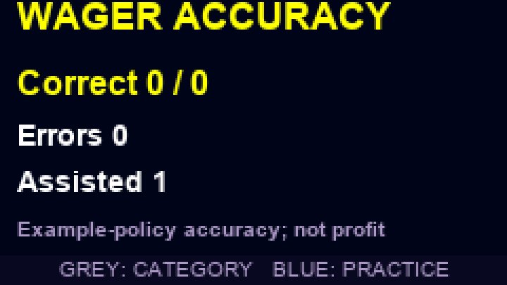](media/screens/native/wager-stats-00.png)

Overall and count-band/funding categories retain correct, error and assisted counts for first wager answers. They do not merge with play or count-quiz accuracy.

**Buttons:** Grey changes category; Blue returns to Wager practice.

**Use:** Find weak count bands or table/bankroll-limit decisions.

<details>
<summary>Additional captured pages / variants (6)</summary>

- [wager-stats-01](media/screens/wager-stats-01.png) · [native 240×135](media/screens/native/wager-stats-01.png)
- [wager-stats-02](media/screens/wager-stats-02.png) · [native 240×135](media/screens/native/wager-stats-02.png)
- [wager-stats-03](media/screens/wager-stats-03.png) · [native 240×135](media/screens/native/wager-stats-03.png)
- [wager-stats-04](media/screens/wager-stats-04.png) · [native 240×135](media/screens/native/wager-stats-04.png)
- [wager-stats-05](media/screens/wager-stats-05.png) · [native 240×135](media/screens/native/wager-stats-05.png)
- [wager-stats-06](media/screens/wager-stats-06.png) · [native 240×135](media/screens/native/wager-stats-06.png)

</details>

### Wager evidence history

**Open:** Wager practice → Wager history.

[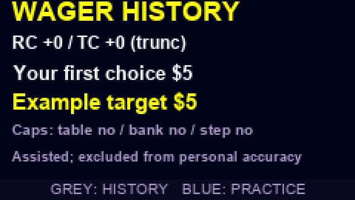](media/screens/native/wager-history.png)

The original predeal context, your amount and example capped answer stay together. Viewing a matching live reference supplies assistance rather than silently improving the score.

**Buttons:** Grey advances history; Blue returns to Wager practice.

**Use:** Revisit why a particular first amount was classified as it was.

### Editable example unit ramp

**Open:** Wager practice → Example unit ramp.

[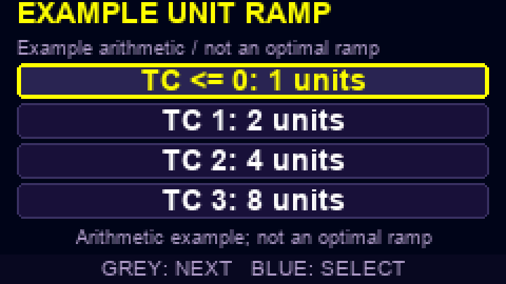](media/screens/native/wager-policy.png)

The five band rows expose the example units. The initial spread is 1/2/4/8/12 units; legal wager limits and funding still cap the applied amount. Changes require a completed-round context.

**Buttons:** Grey selects a band; Blue cycles its example units. Select Return to leave.

**Use:** Make the exercise’s assumptions inspectable rather than treating a spread as hidden advice.

## Synthetic Hi-Lo deviation drills

### Deviation practice setup

**Open:** Training → Deviation drills.

[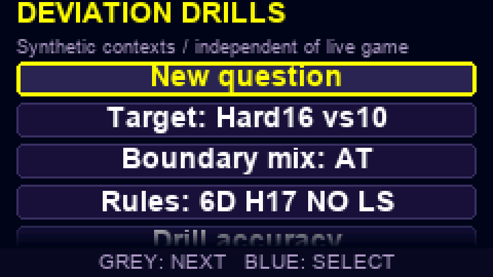](media/screens/native/deviation-practice.png)

Target, below/at/above boundary mix and explicit practice rule profile are separate settings. Start, first-attempt statistics, missed replay, history and policy notes are available here. The drill generator does not consume the live shoe/RNG.

**Buttons:** Grey advances; Blue selects or changes the highlighted setting.

**Use:** Practice index decisions without waiting for the live game to produce them.

### Target selector

**Open:** Deviation drills → Target.

[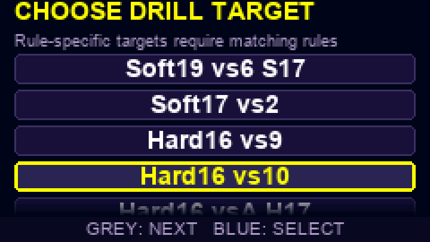](media/screens/native/deviation-target.png)

The selector lists 31 named targets plus Mixed targets. Availability depends on the selected practice rules; unsupported target/profile combinations are refused.

**Buttons:** Grey advances the list; Blue chooses the target.

**Use:** Focus a session on one threshold or deliberately mix targets.

### Public drill question

**Open:** Deviation drills → Start, Next, or missed replay.

[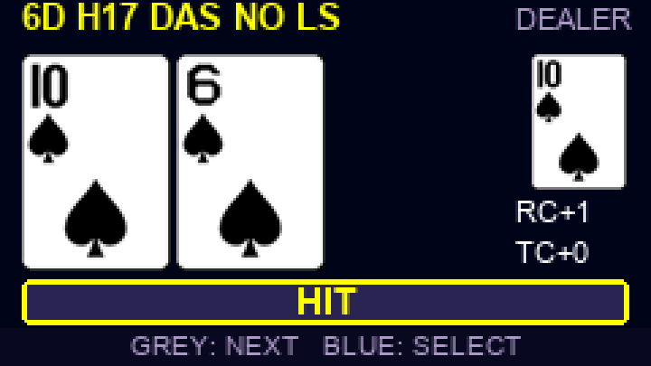](media/screens/native/deviation-question.png)

Large synthetic player cards, dealer upcard, stated rules and RC/TC are the decision inputs. The single selected row cycles legal actions, original context, assisted reference and cancel. Insurance and three-card surrender-priority contexts have their own real layouts.

**Buttons:** Grey changes the selected option; Blue answers or opens it.

**Use:** Answer from the stated public context before unlocking the recommendation.

<details>
<summary>Additional captured pages / variants (3)</summary>

- [deviation-insurance](media/screens/deviation-insurance.png) · [native 240×135](media/screens/native/deviation-insurance.png)
- [deviation-three-cards](media/screens/deviation-three-cards.png) · [native 240×135](media/screens/native/deviation-three-cards.png)
- [deviation-replay](media/screens/deviation-replay.png) · [native 240×135](media/screens/native/deviation-replay.png)

</details>

### Original rules/count context

**Open:** Drill question → Original rules / count.

[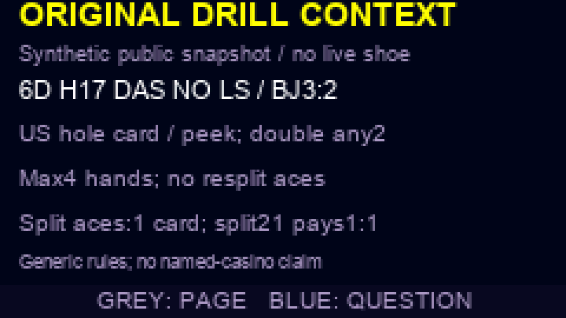](media/screens/native/deviation-context-00.png)

Three pages retain original rules, count/deck-divisor conventions and funding/legal context. Reading context alone does not reveal the policy answer or mark it assisted.

**Buttons:** Grey changes page; Blue returns to the question.

**Use:** Verify what question was asked, rather than assuming it uses the live table’s profile.

<details>
<summary>Additional captured pages / variants (2)</summary>

- [deviation-context-01](media/screens/deviation-context-01.png) · [native 240×135](media/screens/native/deviation-context-01.png)
- [deviation-context-02](media/screens/deviation-context-02.png) · [native 240×135](media/screens/native/deviation-context-02.png)

</details>

### Gated index reference

**Open:** Drill question → Show reference (assisted).

[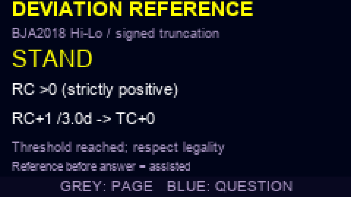](media/screens/native/deviation-reference-00.png)

The best action, threshold and source-policy explanation become available. Before an answer this is sticky assistance; after grading it explains the retained first decision.

**Buttons:** Grey changes reference page; Blue returns to the question.

**Use:** Inspect the published-policy boundary without pretending the first answer was unaided.

<details>
<summary>Additional captured pages / variants (1)</summary>

- [deviation-reference-01](media/screens/deviation-reference-01.png) · [native 240×135](media/screens/native/deviation-reference-01.png)

</details>

### Immutable drill result

**Open:** Choose a legal drill answer.

[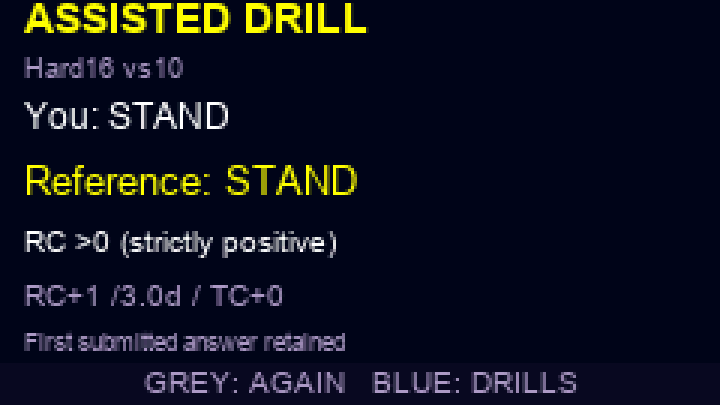](media/screens/native/deviation-result.png)

Your first choice, best action and assistance classification appear together. First attempts and missed replays have separate totals. Repeating or correcting a situation cannot erase its original mistake.

**Buttons:** Grey starts a new question; Blue returns to the drill menu.

**Use:** Connect a result with its precise original threshold/context.

<details>
<summary>Additional captured pages / variants (1)</summary>

- [deviation-replay-result](media/screens/deviation-replay-result.png) · [native 240×135](media/screens/native/deviation-replay-result.png)

</details>

### First-attempt and replay statistics

**Open:** Deviation drills → Accuracy.

[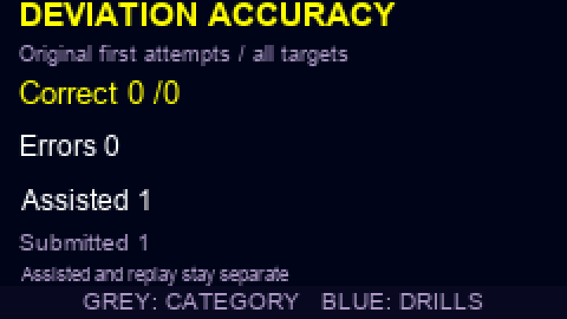](media/screens/native/deviation-stats-00.png)

Overall and per-target pages distinguish original attempts from replays and assistance. Empty target pages remain empty rather than inheriting another target’s score.

**Buttons:** Grey advances overall/target pages; Blue returns to the drill menu.

**Use:** Find targets needing work while keeping replay practice honest.

<details>
<summary>Additional captured pages / variants (33)</summary>

- [deviation-stats-01](media/screens/deviation-stats-01.png) · [native 240×135](media/screens/native/deviation-stats-01.png)
- [deviation-stats-02](media/screens/deviation-stats-02.png) · [native 240×135](media/screens/native/deviation-stats-02.png)
- [deviation-stats-03](media/screens/deviation-stats-03.png) · [native 240×135](media/screens/native/deviation-stats-03.png)
- [deviation-stats-04](media/screens/deviation-stats-04.png) · [native 240×135](media/screens/native/deviation-stats-04.png)
- [deviation-stats-05](media/screens/deviation-stats-05.png) · [native 240×135](media/screens/native/deviation-stats-05.png)
- [deviation-stats-06](media/screens/deviation-stats-06.png) · [native 240×135](media/screens/native/deviation-stats-06.png)
- [deviation-stats-07](media/screens/deviation-stats-07.png) · [native 240×135](media/screens/native/deviation-stats-07.png)
- [deviation-stats-08](media/screens/deviation-stats-08.png) · [native 240×135](media/screens/native/deviation-stats-08.png)
- [deviation-stats-09](media/screens/deviation-stats-09.png) · [native 240×135](media/screens/native/deviation-stats-09.png)
- [deviation-stats-10](media/screens/deviation-stats-10.png) · [native 240×135](media/screens/native/deviation-stats-10.png)
- [deviation-stats-11](media/screens/deviation-stats-11.png) · [native 240×135](media/screens/native/deviation-stats-11.png)
- [deviation-stats-12](media/screens/deviation-stats-12.png) · [native 240×135](media/screens/native/deviation-stats-12.png)
- [deviation-stats-13](media/screens/deviation-stats-13.png) · [native 240×135](media/screens/native/deviation-stats-13.png)
- [deviation-stats-14](media/screens/deviation-stats-14.png) · [native 240×135](media/screens/native/deviation-stats-14.png)
- [deviation-stats-15](media/screens/deviation-stats-15.png) · [native 240×135](media/screens/native/deviation-stats-15.png)
- [deviation-stats-16](media/screens/deviation-stats-16.png) · [native 240×135](media/screens/native/deviation-stats-16.png)
- [deviation-stats-17](media/screens/deviation-stats-17.png) · [native 240×135](media/screens/native/deviation-stats-17.png)
- [deviation-stats-18](media/screens/deviation-stats-18.png) · [native 240×135](media/screens/native/deviation-stats-18.png)
- [deviation-stats-19](media/screens/deviation-stats-19.png) · [native 240×135](media/screens/native/deviation-stats-19.png)
- [deviation-stats-20](media/screens/deviation-stats-20.png) · [native 240×135](media/screens/native/deviation-stats-20.png)
- [deviation-stats-21](media/screens/deviation-stats-21.png) · [native 240×135](media/screens/native/deviation-stats-21.png)
- [deviation-stats-22](media/screens/deviation-stats-22.png) · [native 240×135](media/screens/native/deviation-stats-22.png)
- [deviation-stats-23](media/screens/deviation-stats-23.png) · [native 240×135](media/screens/native/deviation-stats-23.png)
- [deviation-stats-24](media/screens/deviation-stats-24.png) · [native 240×135](media/screens/native/deviation-stats-24.png)
- [deviation-stats-25](media/screens/deviation-stats-25.png) · [native 240×135](media/screens/native/deviation-stats-25.png)
- [deviation-stats-26](media/screens/deviation-stats-26.png) · [native 240×135](media/screens/native/deviation-stats-26.png)
- [deviation-stats-27](media/screens/deviation-stats-27.png) · [native 240×135](media/screens/native/deviation-stats-27.png)
- [deviation-stats-28](media/screens/deviation-stats-28.png) · [native 240×135](media/screens/native/deviation-stats-28.png)
- [deviation-stats-29](media/screens/deviation-stats-29.png) · [native 240×135](media/screens/native/deviation-stats-29.png)
- [deviation-stats-30](media/screens/deviation-stats-30.png) · [native 240×135](media/screens/native/deviation-stats-30.png)
- [deviation-stats-31](media/screens/deviation-stats-31.png) · [native 240×135](media/screens/native/deviation-stats-31.png)
- [deviation-stats-32](media/screens/deviation-stats-32.png) · [native 240×135](media/screens/native/deviation-stats-32.png)
- [deviation-replay-stats](media/screens/deviation-replay-stats.png) · [native 240×135](media/screens/native/deviation-replay-stats.png)

</details>

### Original drill evidence pages

**Open:** Deviation drills → History.

[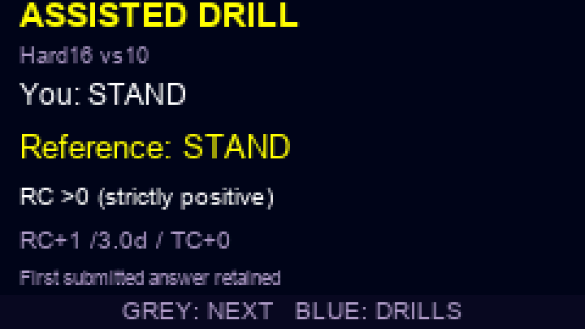](media/screens/native/deviation-history-00.png)

Each saved attempt has a six-page evidence cycle: original public context, choices, reference and classification remain attached to the original token.

**Buttons:** Grey advances evidence/history pages; Blue returns to the drill menu.

**Use:** Audit the question and answer that generated a statistic.

<details>
<summary>Additional captured pages / variants (5)</summary>

- [deviation-history-01](media/screens/deviation-history-01.png) · [native 240×135](media/screens/native/deviation-history-01.png)
- [deviation-history-02](media/screens/deviation-history-02.png) · [native 240×135](media/screens/native/deviation-history-02.png)
- [deviation-history-03](media/screens/deviation-history-03.png) · [native 240×135](media/screens/native/deviation-history-03.png)
- [deviation-history-04](media/screens/deviation-history-04.png) · [native 240×135](media/screens/native/deviation-history-04.png)
- [deviation-history-05](media/screens/deviation-history-05.png) · [native 240×135](media/screens/native/deviation-history-05.png)

</details>

### Drill conventions and scope

**Open:** Deviation drills → Policy / conventions.

[](media/screens/native/deviation-policy-00.png)

Four pages explain the named Hi-Lo policy, integer-TC/RC exceptions, supported rules and synthetic-exercise scope. They are policy notes, not an exact composition-dependent EV calculation.

**Buttons:** Grey changes page; Blue returns to the drill menu.

**Use:** Understand what the drill evaluates and where its recommendations apply.

<details>
<summary>Additional captured pages / variants (3)</summary>

- [deviation-policy-01](media/screens/deviation-policy-01.png) · [native 240×135](media/screens/native/deviation-policy-01.png)
- [deviation-policy-02](media/screens/deviation-policy-02.png) · [native 240×135](media/screens/native/deviation-policy-02.png)
- [deviation-policy-03](media/screens/deviation-policy-03.png) · [native 240×135](media/screens/native/deviation-policy-03.png)

</details>

## Table and shoe configuration

### Pending table profile

**Open:** Menu → Table profile between rounds.

[](media/screens/native/profile.png)

Preset, minimum, maximum, penetration and seating are edited as a pending profile. Applying the profile starts the appropriate new-shoe flow; it does not claim a named casino currently offers that exact combination.

**Buttons:** Grey advances; Blue opens an editor, applies changes or returns.

**Use:** Keep table conditions explicit and avoid changing rules during a live round.

### Supported rule presets

**Open:** Table profile → Preset.

[](media/screens/native/profile-preset.png)

Six supported combinations cover the displayed deck/H17/S17/DAS/surrender/payout differences. The selected table minimum/maximum and penetration are retained when changing the preset.

**Buttons:** Grey advances; Blue selects the preset or Return.

**Use:** Choose a supported strategy/rule combination with visible scope.

### Table minimum/maximum editor

**Open:** Table profile → Minimum or Maximum.

[](media/screens/native/profile-minimum.png)

The same amount editor labels whether it is editing the minimum or maximum. Values stay within the supported bounds and consistent with the other limit; they are pending until the profile is applied.

**Buttons:** Grey chooses add/subtract/accept; Blue executes it.

**Use:** Set training limits independently from a single live wager.

<details>
<summary>Additional captured pages / variants (1)</summary>

- [profile-maximum](media/screens/profile-maximum.png) · [native 240×135](media/screens/native/profile-maximum.png)

</details>

### Dealer marker / penetration

**Open:** Table profile → Penetration.

[](media/screens/native/profile-depth.png)

Available depths are 50/60/70/75/80/85/90%. This is the dealer marker, not the earlier player cut. A marked shoe finishes the active round before the next shuffle/cut.

**Buttons:** Grey chooses depth; Blue selects it or Return.

**Use:** Control how deep the simulated shoe runs under explicit exhaustion handling.

### Optional tablemates and player position

**Open:** Table profile → Tablemates.

[](media/screens/native/table-seats.png)

Up to six extra seats and the player’s place in the dealing order are configurable. Apply requires a completed round. Their chips/results remain separate from the player’s session reports.

**Buttons:** Grey advances; Blue changes extra-seat count/position, applies, reviews cards or returns.

**Use:** Practice the visible-card flow of a fuller table.

[](media/tablemates.gif)

*A separate synthetic player-first branch shows timed tablemate play after the player action. Initial faces and later draws receive their own visible stages; their chips remain separate from the player’s results.*

### Public shoe quantities

**Open:** Menu → Shoe information.

[](media/screens/native/shoe-info.png)

Physical remaining, held/discard, marker and exceptional-refill quantities explain the shoe’s state without exposing faces/order. This screen is an information aid when its context matches a live decision.

**Buttons:** Blue returns to the menu.

**Use:** Understand penetration, count divisors and discard-only recovery using public quantities.

### In-game rulebook

**Open:** Menu → Table rules.

[](media/screens/native/rules-00.png)

Seven pages cover the current profile, split/double, surrender, peek/insurance, virtual-session notes, optional tablemates and rare exhaustion. Page 4 contains pre-resume save wording: read it as the default resume Off summary; optional exact resume is documented separately.

**Buttons:** Grey changes page; Blue returns to the menu.

**Use:** Check the active simulation’s conditions and limits instead of relying on a generic casino label.

**Current-copy caveat:** the virtual-session page describes the default resumeOff behavior using pre-resume wording. Optional private resume can also preserve active hands/history; see [Save and resume](RESUME.md) for the current behavior.

<details>
<summary>Additional captured pages / variants (6)</summary>

- [rules-01](media/screens/rules-01.png) · [native 240×135](media/screens/native/rules-01.png)
- [rules-02](media/screens/rules-02.png) · [native 240×135](media/screens/native/rules-02.png)
- [rules-03](media/screens/rules-03.png) · [native 240×135](media/screens/native/rules-03.png)
- [rules-04](media/screens/rules-04.png) · [native 240×135](media/screens/native/rules-04.png)
- [rules-05](media/screens/rules-05.png) · [native 240×135](media/screens/native/rules-05.png)
- [rules-06](media/screens/rules-06.png) · [native 240×135](media/screens/native/rules-06.png)

</details>

## Session reports

### Session totals hub

**Open:** Menu → Session totals.

[](media/screens/native/session.png)

The header shows settled rounds and gambling net. Bankroll details, a deposit, Session analysis and Color up are distinct operations. Deposits are not winnings.

**Buttons:** Grey advances; Blue opens the highlighted operation.

**Use:** Keep session outcomes, funding and long-term training scores separate.

### Session funding and outcomes

**Open:** Session totals → Bankroll details.

[](media/screens/native/bankroll-00.png)

One page shows chips, deposits, cashouts and net; the other shows win/loss/push/round totals and committed chips. Numbers belong only to this synthetic session.

**Buttons:** Grey changes page; Blue returns to Session totals.

**Use:** Reconcile the available balance with funding and unsettled commitments.

<details>
<summary>Additional captured pages / variants (1)</summary>

- [bankroll-01](media/screens/bankroll-01.png) · [native 240×135](media/screens/native/bankroll-01.png)

</details>

### Analysis navigation

**Open:** Session totals → Session analysis.

[](media/screens/native/analysis-menu.png)

Summary, net graph, settled rounds, first-answer accuracy, Basic model differences, decision history and assumptions are separate reports. Analysis is menu-only; it does not change the live hand.

**Buttons:** Grey advances; Blue opens a report or returns to Session totals.

**Use:** Choose the kind of evidence before interpreting a performance number.

### Mean, dispersion and reference band

**Open:** Session analysis → Summary.

[](media/screens/native/analysis-summary-00.png)

Four pages separate outcomes, mean/dispersion, drawdown and a sufficiently sampled IID-normal reference calculation. The reference is explicitly not an advantage confidence interval or a profit forecast.

**Buttons:** Grey changes page; Blue returns to Analysis.

**Use:** Describe a completed session without claiming future profitability.

<details>
<summary>Additional captured pages / variants (3)</summary>

- [analysis-summary-01](media/screens/analysis-summary-01.png) · [native 240×135](media/screens/native/analysis-summary-01.png)
- [analysis-summary-02](media/screens/analysis-summary-02.png) · [native 240×135](media/screens/native/analysis-summary-02.png)
- [analysis-summary-03](media/screens/analysis-summary-03.png) · [native 240×135](media/screens/native/analysis-summary-03.png)

</details>

### Session net-history graph

**Open:** Session analysis → Net history.

[](media/screens/native/analysis-graph-00.png)

The line uses settled-round gambling net and the bounded recent history; funding is excluded. The displayed max drawdown is a session outcome measure, not a future-loss limit.

**Buttons:** Blue returns to Analysis. Grey has no page action here.

**Use:** See the path of realized outcomes rather than only the endpoint.

### Settled-round ledger

**Open:** Session analysis → Settled rounds.

[](media/screens/native/analysis-rounds-00.png)

Each record retains round ID, base wager, total stake/return and chips at settlement. Tablemates’ money does not enter this ledger.

**Buttons:** Grey advances through retained rounds; Blue returns to Analysis.

**Use:** Reconcile split/double/insurance funding and the round outcome.

<details>
<summary>Additional captured pages / variants (1)</summary>

- [analysis-rounds-01](media/screens/analysis-rounds-01.png) · [native 240×135](media/screens/native/analysis-rounds-01.png)

</details>

### Session first-answer categories

**Open:** Session analysis → Accuracy / weak areas.

[](media/screens/native/analysis-accuracy-00.png)

Twelve category pages combine current-session evidence while keeping play, count, wager and deviation categories identifiable. Assisted and unassisted results remain distinct.

**Buttons:** Grey changes category; Blue returns to Analysis.

**Use:** Choose a focused practice area from this session rather than lifetime aggregates alone.

<details>
<summary>Additional captured pages / variants (11)</summary>

- [analysis-accuracy-01](media/screens/analysis-accuracy-01.png) · [native 240×135](media/screens/native/analysis-accuracy-01.png)
- [analysis-accuracy-02](media/screens/analysis-accuracy-02.png) · [native 240×135](media/screens/native/analysis-accuracy-02.png)
- [analysis-accuracy-03](media/screens/analysis-accuracy-03.png) · [native 240×135](media/screens/native/analysis-accuracy-03.png)
- [analysis-accuracy-04](media/screens/analysis-accuracy-04.png) · [native 240×135](media/screens/native/analysis-accuracy-04.png)
- [analysis-accuracy-05](media/screens/analysis-accuracy-05.png) · [native 240×135](media/screens/native/analysis-accuracy-05.png)
- [analysis-accuracy-06](media/screens/analysis-accuracy-06.png) · [native 240×135](media/screens/native/analysis-accuracy-06.png)
- [analysis-accuracy-07](media/screens/analysis-accuracy-07.png) · [native 240×135](media/screens/native/analysis-accuracy-07.png)
- [analysis-accuracy-08](media/screens/analysis-accuracy-08.png) · [native 240×135](media/screens/native/analysis-accuracy-08.png)
- [analysis-accuracy-09](media/screens/analysis-accuracy-09.png) · [native 240×135](media/screens/native/analysis-accuracy-09.png)
- [analysis-accuracy-10](media/screens/analysis-accuracy-10.png) · [native 240×135](media/screens/native/analysis-accuracy-10.png)
- [analysis-accuracy-11](media/screens/analysis-accuracy-11.png) · [native 240×135](media/screens/native/analysis-accuracy-11.png)

</details>

### Basic-model decision differences

**Open:** Session analysis → Basic EV differences.

[](media/screens/native/analysis-costs-00.png)

Three pages distinguish unassisted, assisted and skipped/unavailable evidence. Only complete eligible Basic-model comparisons contribute; Hi-Lo or incomplete split evidence is not silently converted into zero.

**Buttons:** Grey changes page; Blue returns to Analysis.

**Use:** Read model expectation differences separately from realized chips or Hi-Lo advantage claims.

<details>
<summary>Additional captured pages / variants (3)</summary>

- [analysis-costs-01](media/screens/analysis-costs-01.png) · [native 240×135](media/screens/native/analysis-costs-01.png)
- [analysis-costs-02](media/screens/analysis-costs-02.png) · [native 240×135](media/screens/native/analysis-costs-02.png)
- [analysis-costs-hilo-unavailable](media/screens/analysis-costs-hilo-unavailable.png) · [native 240×135](media/screens/native/analysis-costs-hilo-unavailable.png)

</details>

### Session original-answer evidence

**Open:** Session analysis → First-answer history.

[](media/screens/native/analysis-decisions-00.png)

The bounded history retains original first choices, classification and any eligible model evidence. Viewing a live-matching reference can itself be an aid.

**Buttons:** Grey advances retained answers; Blue returns to Analysis.

**Use:** Trace a session report back to recorded decisions.

<details>
<summary>Additional captured pages / variants (1)</summary>

- [analysis-decisions-01](media/screens/analysis-decisions-01.png) · [native 240×135](media/screens/native/analysis-decisions-01.png)

</details>

### Analysis assumptions

**Open:** Session analysis → Assumptions.

[](media/screens/native/analysis-assumptions-00.png)

Three pages state the sample/model limits, funding exclusions and interpretation caveats. Unavailable reports stay labeled rather than inventing certainty from a small sample.

**Buttons:** Grey changes page; Blue returns to Analysis.

**Use:** Read the conditions behind the figures before drawing conclusions.

<details>
<summary>Additional captured pages / variants (2)</summary>

- [analysis-assumptions-01](media/screens/analysis-assumptions-01.png) · [native 240×135](media/screens/native/analysis-assumptions-01.png)
- [analysis-assumptions-02](media/screens/analysis-assumptions-02.png) · [native 240×135](media/screens/native/analysis-assumptions-02.png)

</details>

## Settings and on-device controls

### Settings hub

**Open:** Menu → Settings.

[](media/screens/native/settings.png)

Display, Sound, Speed, deposit, independent count-display preference, optional resume and Return are the seven rows. Fast is the fresh default. Guide’s count-display preference is separate from other modes.

**Buttons:** Grey advances; Blue opens or toggles the highlighted row.

**Use:** Customize presentation and optional persistence without crowding the main table.

<details>
<summary>Additional captured pages / variants (2)</summary>

- [settings-resume](media/screens/settings-resume.png) · [native 240×135](media/screens/native/settings-resume.png)
- [settings-normal-speed](media/screens/settings-normal-speed.png) · [native 240×135](media/screens/native/settings-normal-speed.png)

</details>

### Display submenu

**Open:** Settings → Display.

[](media/screens/native/display.png)

Brightness and Flip screen are separate options. Flip affects device/browser presentation; these gallery images retain logical native orientation.

**Buttons:** Grey advances; Blue opens Brightness, toggles Flip or returns. Hold Grey returns to Settings.

**Use:** Adapt the display while retaining the same two-button navigation.

### Percentage brightness editor

**Open:** Display → Brightness.

[](media/screens/native/brightness.png)

The editor displays a percentage and clamps the readable range at about 8–100%. It changes display level, not the native art or game logic.

**Buttons:** Grey lowers; Blue raises in five-point steps. Hold Grey returns to Display.

**Use:** Adjust the display without cycling training mode or navigating amount rows.

### Sound submenu and named auditions

**Open:** Settings → Sound.

[](media/screens/native/sound.png)

Master, 20% default volume, independent Menus/Cards/Results categories and named deal/win/menu tests are shown. Master mute preserves category and volume settings and silences auditions too.

**Buttons:** Grey advances; Blue toggles/opens/auditions the row. Hold Grey returns to Settings.

**Use:** Control feedback sources without marking a training answer assisted.

<details>
<summary>Additional captured pages / variants (1)</summary>

- [sound-auditions](media/screens/sound-auditions.png) · [native 240×135](media/screens/native/sound-auditions.png)

</details>

### Percentage volume editor

**Open:** Sound → Volume.

[](media/screens/native/audio-volume.png)

The editor provides one-point steps through 0–10%, then five-point steps up to 100%. Zero volume silences playback; auditions respect master mute and the selected level.

**Buttons:** Grey lowers; Blue raises; hold Blue auditions a deal. Hold Grey returns to Sound.

**Use:** Set a usable quiet level with immediate, advice-free feedback.

### Built-in control reference

**Open:** Menu → Controls.

[](media/screens/native/controls-00.png)

Four pages cover normal table taps, the unified menu, consumed hold releases and count-only simultaneous submission. Nested brightness/volume editors retain their own stated hold behavior.

**Buttons:** Grey changes page; Blue returns to the menu.

**Use:** Recover app-specific navigation quickly without a separate manual.

<details>
<summary>Additional captured pages / variants (3)</summary>

- [controls-01](media/screens/controls-01.png) · [native 240×135](media/screens/native/controls-01.png)
- [controls-02](media/screens/controls-02.png) · [native 240×135](media/screens/native/controls-02.png)
- [controls-03](media/screens/controls-03.png) · [native 240×135](media/screens/native/controls-03.png)

</details>

## Save, resume and recovery

These are the shared production draw-only recovery layouts, rendered with a fresh synthetic App. They do not read a checkpoint, induce a storage failure, or display anyone’s saved game. Resume is Off by default; only an explicit Resume selection restores a saved live mode. See [Resume](RESUME.md) for journal behavior and checkpoint limits.

**Current-layout note:** some long recovery-choice labels are clipped at native width in this build. The captions below spell out the full choices; the captures preserve the actual renderer unchanged.

### Resume a saved session

[](media/screens/native/resume-chooser.png)

A valid matching private checkpoint is available on an opted-in boot. Grey chooses **Resume saved session** or **Start a new session**; Blue explicitly selects. Only Resume restores the saved live mode. Release both buttons so a boot-held key is not treated as a play.

### Saved scores cannot be read

[](media/screens/native/read-retry.png)

The initial public read failed, so saved totals are unavailable rather than assumed zero. Grey chooses **Retry reading saved scores** or **Start fresh without saving**; Blue confirms. The fresh RAM path leaves both journals untouched and labels UNSAVED.

### Protected save cannot be acknowledged

[](media/screens/native/save-retry.png)

SAVE RETRY holds the new answer/feedback behind the public acknowledgment gate. Grey selects **Retry saving session** or **Start fresh without saving**; Blue confirms. Fresh RAM discards the pending session, keeps only known acknowledged totals/preferences and disables resume/writes for that boot.

### Fresh RAM-only presentation

[](media/screens/native/unsaved.png)

UNSAVED remains visible during the fresh independent session. Resume cannot be reenabled for that RAM-only boot. No journal writes/deletes occur; after a later reboot the last valid durable checkpoint may still be offered.

## Reproducing and auditing this gallery

Run from the project root with a native Rust toolchain and Python/Pillow installed:

```sh
python3 tools/publication_screens.py
```

The helper runs `cargo run --offline --locked --release --features validation --example publication_screens`, stores intermediate PPM frames under `work/`, and writes this guide plus `docs/media`. It uses only public App controls/state and existing fixed public validation cases. Recovery examples use the existing draw-only helpers. It never opens USB, loads a save or imports private recovery data.

The generator checks all 65 current `View` variants against the actual captured public view names and this caption catalogue. It verifies 240×135 originals, exact 3× PNG replication, GIF frames derived from the real captures and unchanged runtime/source assets during rendering.

- [Complete screen inventory](media/screen-inventory.json)
- [Frame provenance, synthetic seeds and image hashes](media/screen-manifest.json)
- [Native PNG directory](media/screens/native/)
- [Reproducible native example](../examples/publication_screens.rs)
- [Rendering / gallery helper](../tools/publication_screens.py)
- [Caption catalogue](../tools/publication_catalog.py)

Generated scores illustrate the interface only. They are not physical-device acceptance evidence, historical player results, a casino advantage claim or a forecast. This preparation creates local review files; it performs no GitHub upload or external publication.
