# Waveshare 1.75-inch round Blackjack Trainer

The **ESP32-S3-Touch-AMOLED-1.75C** runs the same Rust Blackjack game and trainers as StickS3, with a native **466 × 466** circular interface. Hold it with both buttons at the top, matching Seeder and Stopwatch. The enclosure orientation is **270°**; pixels rotate in software to keep the lettering upright.

**The touchscreen is disabled.** Its reset pin stays low. No game, menu, calibration or startup step uses touch.

## Two buttons

| Physical button, with buttons at the top | During a hand | In menus |
|---|---|---|
| Large button on the left | Tap to Stand; hold to cycle Off → Test → Coach → Guide | Tap to select |
| Small button on the right | Tap to Hit; hold for the combined menu and extra actions | Tap for next; hold to go back |
| Both together | Submit an active count quiz | No touchscreen shortcut |

During insurance, select the displayed Yes/Decline choice with the left button and change it with the right. The question and choices remain visible in Guide mode. Double, split, surrender and insurance follow the selected table's rules and legal actions.

On a normal fresh session, **left twice** accepts the randomized player cut and skips the burn notice into the hand. Starting bankroll is $1,000, training is Off, and the table minimum is selected. New preferences remain Hi-Lo, Fast and 20% sound; saved settings take precedence.

## OLED backgrounds

The round device starts with a **pitch-black** background. Under **Settings → Display → Background**, press the large left button to cycle **Black → Blue → Green → Red**. The choice is saved. The Stick and web versions keep their blue interface.

| Choice | Color |
|---|---|
| Black, the OLED default | `#000000` |
| Blue, the original Video Poker shade | `#0B006B` |
| Green, with the same saturation and value | `#006B0B` |
| Red, with the same saturation and value | `#6B0B00` |

## Card backs

Under **Settings → Display → Card back**, choose **Gold**, **Red** or **Blue**. Each keeps the Stardust pattern and logo; faces keep their original readable white design. This preference is saved on the round device.

| Gold | Red | Blue |
|---|---|---|
| [](media/round/card-back-0.png) | [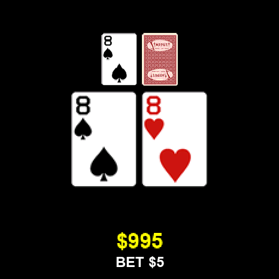](media/round/card-back-1.png) | [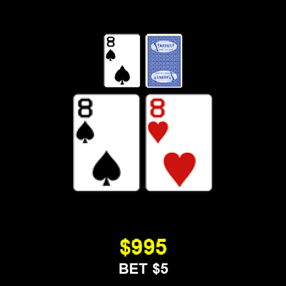](media/round/card-back-2.png) |

## A layout for the circle

Your cards sit in the center of the display, with the smaller dealer cards above. Results, count aids, bankroll and bet sit below your hand. Guide puts advice below your cards; its own RC/TC default remains separate from other modes. Your hand re-centers horizontally as cards arrive. The cards keep their size and height, and larger hands overlap to fit the circular display. Only horizontal spacing changes as cards arrive; card height and size remain fixed through dealer play and results. Split-hand selection, insurance and results stay inside the circular boundary.

Menus use larger native text, six full rows and a faded preview of the next option. Reaching the last full row scrolls the list up by one row; there is no side scrollbar. Specialist trainer and report screens retain the same choices and page navigation, with their content reflowed into the round display. These are the same rules, strategies, EV calculations, count accounting, drills and session reports as the Stick build.

The screen examples below use the actual Rust round renderer with synthetic demonstration sessions. They are not photographs of the physical panel or recordings of a player's saved results.


| Cut the shoe | Skip the burn notice |
|---|---|
| [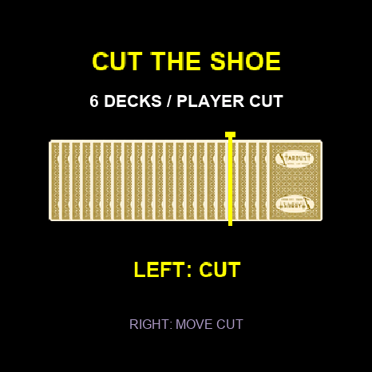](media/round/cut.png) | [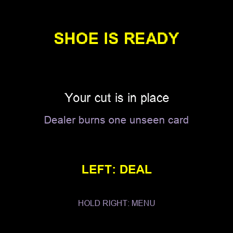](media/round/burn.png) |

| Ready, with a separate wager hint | Three cards, centered after a draw |
|---|---|
| [](media/round/ready-after-cut.png) | [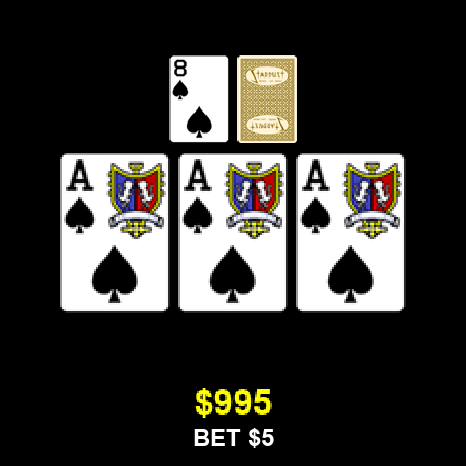](media/round/player-3-cards.png) |

| Your turn | Dealer plays: same card geometry |
|---|---|
| [](media/round/transition-player.png) | [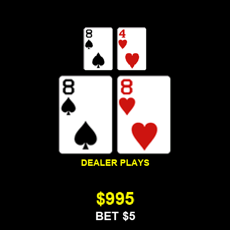](media/round/transition-after-stand.png) |

| Result: same player cards | Guide with its own count default |
|---|---|
| [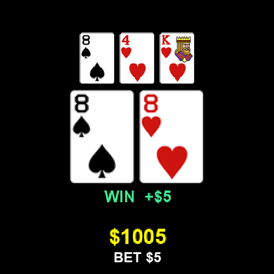](media/round/transition-result.png) | [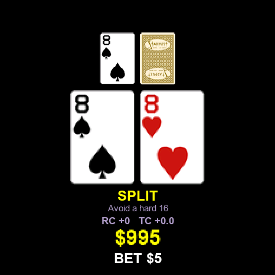](media/round/hand-0-GUIDE.png) |

| Insurance question and choices in Guide | Split-hand selection |
|---|---|
| [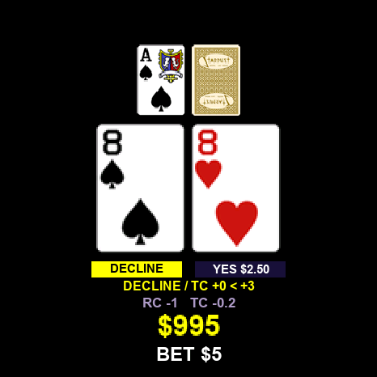](media/round/guide-insurance.png) | [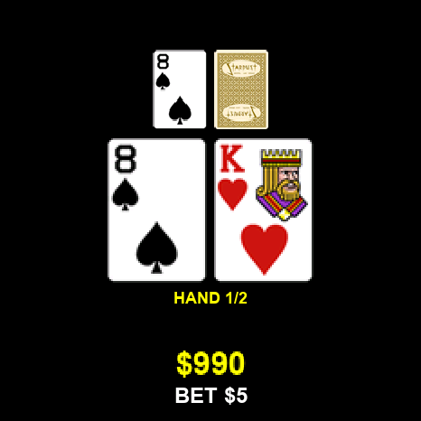](media/round/split-hand.png) |

| Five cards: fixed-size overlapping fan | Main menu |
|---|---|
| [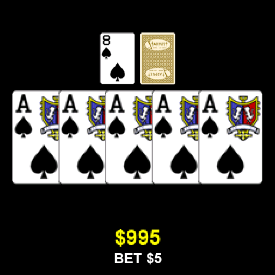](media/round/player-5-cards.png) | [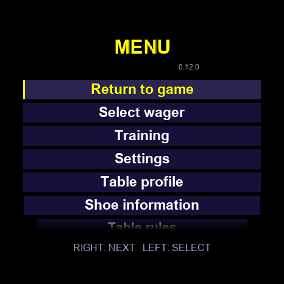](media/round/menu.png) |

| End of the menu and next-row preview | Settings |
|---|---|
| [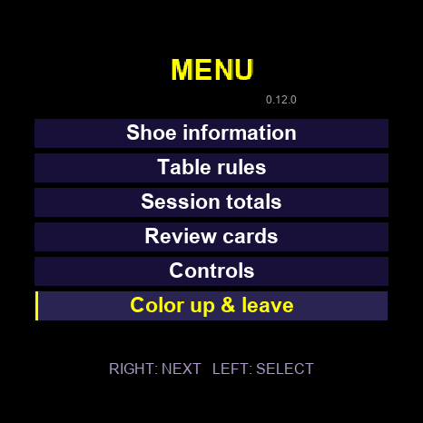](media/round/menu-bottom.png) | [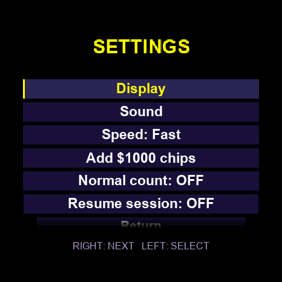](media/round/settings.png) |

| Sound categories and auditions | Volume |
|---|---|
| [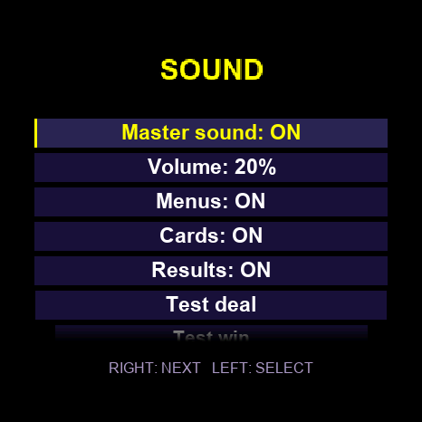](media/round/sound.png) | [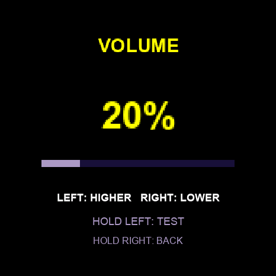](media/round/volume.png) |


| Black | Blue |
|---|---|
| [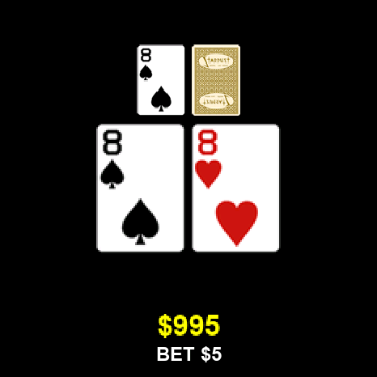](media/round/theme-0.png) | [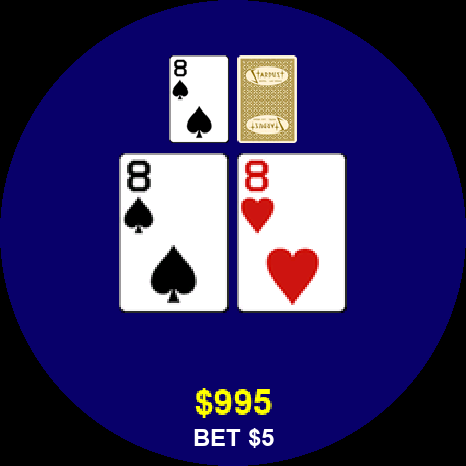](media/round/theme-1.png) |

| Green | Red |
|---|---|
| [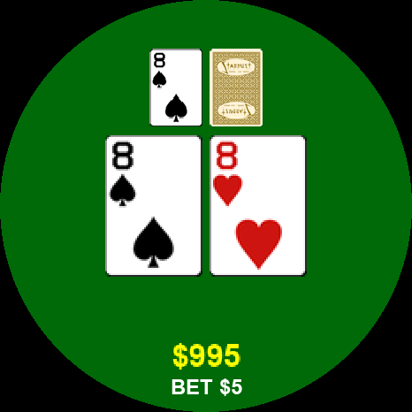](media/round/theme-2.png) | [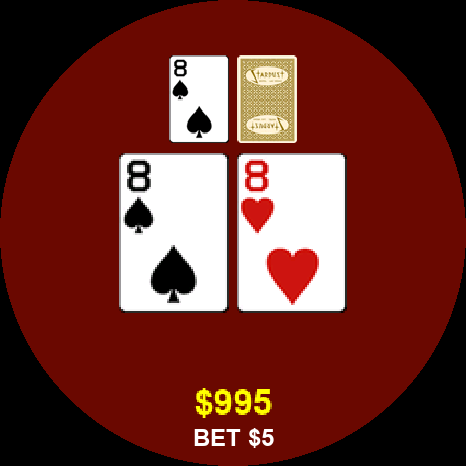](media/round/theme-3.png) |

[Browse all native round examples](media/round) · [Renderer and image provenance](round-screens.json)

## Install or update

Use the [device flasher](https://xn--sg8hhb.ws/flasher/?project=blackjack), select **Waveshare 1.75C** and Blackjack Trainer. Its signed release catalog verifies the matching device, firmware and flash map.

The Waveshare installation is **application only at `0x200000`**. It retains the complete factory partition table, bootloader, calibration/NVS and existing model/storage filesystems. Do not install the Stick image, erase the chip or flash the supplied factory-map reference as a new partition table.

A direct installer is also included:

```sh
python3 tools/flash_waveshare175c.py \
  --port YOUR_SERIAL_PORT --expect-mac YOUR_DEVICE_MAC \
  --application firmware/build-waveshare175c/stardust-waveshare175c.bin \
  --backup-dir recovery/waveshare
```

It identifies the exact 32 MB device, verifies the factory map, backs up overwritten application sectors and verifies the installed bytes. A failed write attempts verified rollback. Actual device backups belong in `recovery/`, not a release or public repository.

## Build from source

Use the existing [Rust toolchain instructions](BUILD.md), then:

```sh
python3 firmware/tools/build.py --board waveshare175c
```

The output is `firmware/build-waveshare175c/`. `--board sticks3` remains the default target. Builders never open serial or flash hardware.

The Waveshare image must fit below `0x770000`: maximum **`0x570000` bytes** from its application start. Blackjack reserves the otherwise unused tail of its factory application allocation for its private resume journal (`0x770000–0x7f0000`) and public settings/scores journal (`0x7f0000–0x7f2000`). These are firmware-owned ranges inside the existing application allocation; no new partition entries are written. The runtime checks the exact factory map and application extent before granting storage write authority. Resume remains optional and off by default.

Touch remains reset, radio is not started, and unused microphones/IMU are put to sleep. Audio uses the board's ES8311 and speaker with the same PCM and volume policy as the Stick. The original factory PMIC rails and charging settings are preserved.
